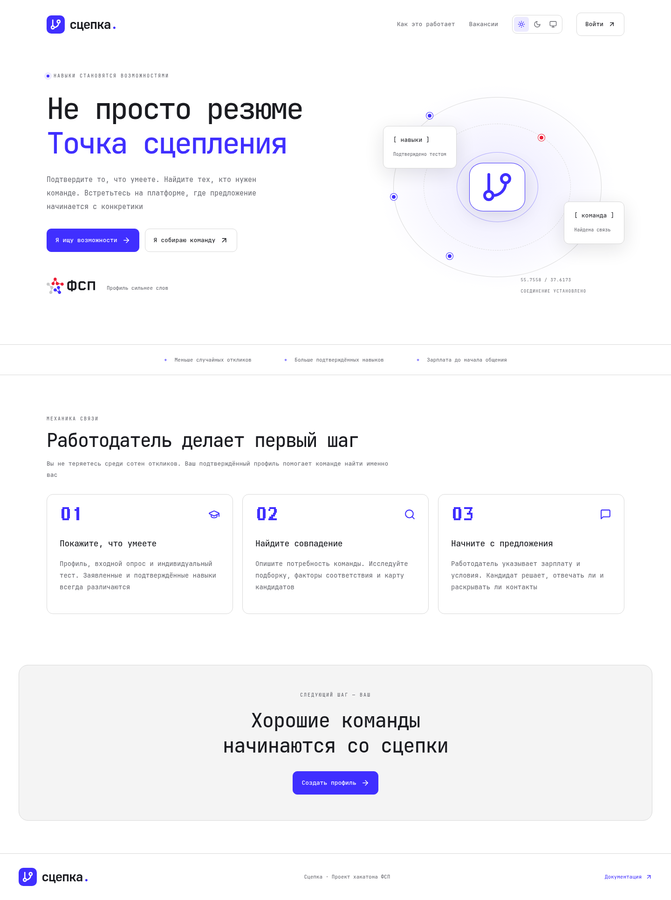
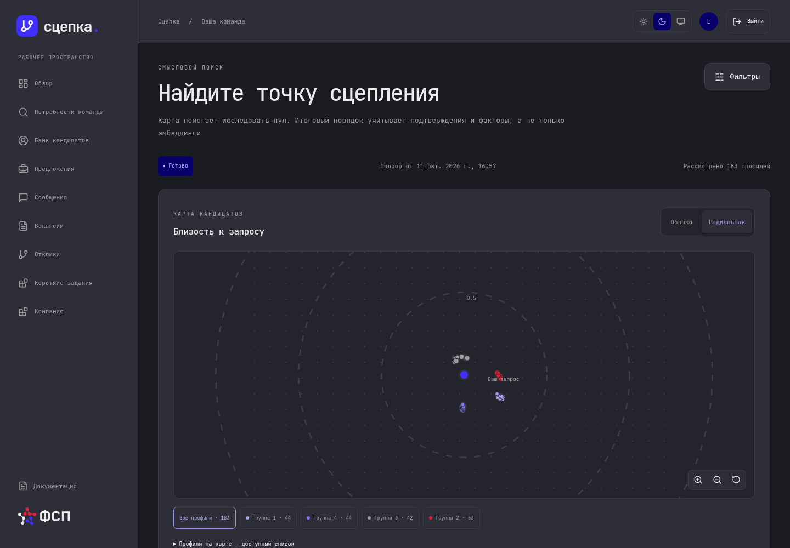
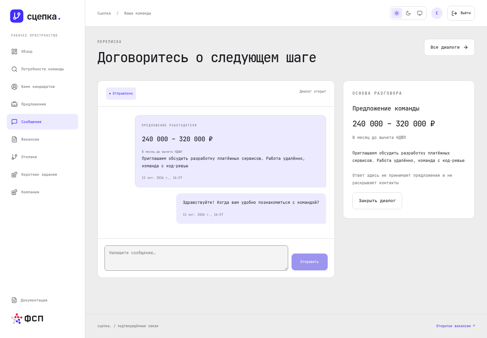

<picture><source media="(prefers-color-scheme: dark)" srcset="brand/assets/logo/logo-short-on-dark.svg"></picture>

# Сцепка

**Подтверждённые навыки. Прямые предложения**

Платформа хакатона ФСП связывает ИТ-кандидатов и работодателей. Кандидат подтверждает заявленный уровень, а работодатель сам находит подходящего человека и направляет предложение с зарплатой

<picture><source media="(prefers-color-scheme: dark)" srcset="docs/frontend/screenshots/landing-dark.png"></picture>

## Для кандидата

- Профиль, навыки и предпочтения, загрузка резюме с подтверждением переноса полей
- Опрос, индивидуальный тест, результаты и история категории
- Предложения с зарплатой до начала общения, переписка и управление контактами
- Вакансии и отклики, короткие задания работодателей, достижения демонстрационного реестра ФСП
- Настраиваемая приватность и собственный PDF-профиль

## Для работодателя

- Профиль компании, потребности команды и опубликованные вакансии
- Подбор с факторами соответствия, фильтрами, уточнениями и историей
- Семантическое облако и радиальная карта рассматривавшихся кандидатов
- Предложения, переписка, отклики и короткие задания

## Удобно на любом экране

Светлая, тёмная и системная темы, адаптация под телефон и планшет, управление с клавиатуры и уменьшение анимаций по настройке устройства

| Радиальная карта в тёмной теме | Переписка с условиями предложения |
| --- | --- |
|  |  |

## Запуск и документация

- [Локальный запуск и демоданные](docs/frontend/development.md)
- [Устройство интерфейса и карт](docs/frontend/architecture.md)
- [Проверки и галерея экранов](docs/frontend/validation.md)
- [API кабинетов](docs/api/frontend.md), [тестирование](docs/taskgen/README.md), [подбор](docs/matcher/README.md), [хранение](docs/database.md)
- [Фирменный стиль и материалы](brand/README.md)

Приложение показывает документацию в разделе `/docs`. Текст берётся из файлов репозитория, а печатное представление использует оформление ФСП

## Компоненты

| Компонент | Назначение |
| --- | --- |
| [frontend](frontend/README.md) | Главная и кабинеты Сцепки |
| [api](api/README.md) | Аккаунты, права, профили, найм и переписка |
| [taskgen](taskgen/README.md) | Индивидуальные задания и оценка ответов |
| [matcher](matcher/README.md) | Подбор и геометрия карт |
| [db](db/README.md) | Предметные данные и миграции |

Синтетические профили отмечены в интерфейсе. Демонстрационная связь с ФСП не подтверждает личность федерацией и не заменяет FSP ID
