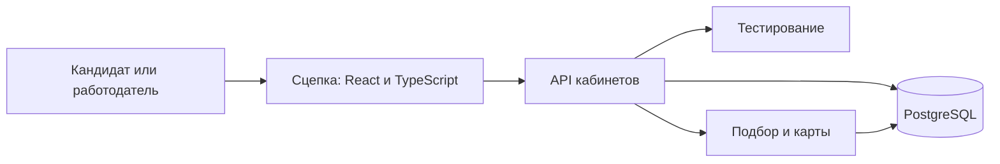

# Устройство интерфейса Сцепки

## Место в платформе

Бизнес-правила принадлежат [API](../api/architecture.md). Фронтенд отображает разрешённые данные, выполняет пользовательские действия и опрашивает сохраняемые операции. Типы HTTP-контракта генерируются из [OpenAPI](../api/openapi.json)

В `frontend/src/App.tsx` находятся маршруты и кабинеты, в `candidate.tsx` — сценарии кандидата, в `hiring.tsx` — найм и переписка. Общие формы и состояния находятся в `ui.tsx`, HTTP-слой — в `api/client.ts`

## Сессия и права

Access token живёт в памяти. Браузер передаёт HttpOnly refresh cookie, а обновление сессии выполняется single-flight с CSRF-проверкой. Proxy удаляет префикс `/api` и меняет путь refresh cookie с `/auth` на `/api/auth`

Вход и выход очищают кеш серверных ответов. После изменения прав интерфейс сбрасывает и перезапрашивает данные. Карточка владельца и карточка работодателя используют разные endpoints и не объединяются

Ключ одного незавершённого действия сохраняется до отправки. Реестр в `api/actions.ts` хранит идентификатор, хэш запроса и состояние, без текста предложения или пароля. Неопределённый результат не создаёт автоматически новое действие

Сообщение имеет собственный `client_message_id`. История подгружается по курсору, а отметка прочтения отправляется отдельно. Содержимое сообщений выводится как обычный текст

## Карты кандидатов

Карта относится к конкретному прогону и показывает его доступный пул после жёсткого префильтра. В неё входят и кандидаты вне короткого списка, а новые и случайные профили сохраняют признаки разведки. Каталог не используется как дополнительный алгоритм подбора

matcher сохраняет приватный снимок использованных векторов и запроса до оценки короткого списка. Это позволяет отдать предварительную геометрию, пока ещё идёт оценка. Ранги появляются только после атомарного сохранения итоговой выдачи

Снимок принадлежит `match.run_map_snapshots`; модель и миграция находятся в API, запись выполняет matcher. Runtime-роль API не читает payload снимка. Основной API проверяет компанию прогона и текущие права каждого кандидата, затем передаёт matcher разрешённое подмножество

PCA даёт двумерную проекцию нормализованных векторов. HDBSCAN ищет группы в исходных векторах, а не на картинке; профили без устойчивой группы остаются шумом. Близость точек в проекции приблизительна и не подтверждает квалификацию

Радиальная карта использует `r = (1 − cosine) / 2`: расстояние до запроса соответствует исходной косинусной близости на общей шкале. Угол берётся из проекции. Масштаб меняет видимую область, а не метрику; расстояния между кандидатами в радиальном режиме не являются исходными расстояниями

Смена исходных данных или прав исключает несовместимую историческую точку. Геометрия строится заново для разрешённого подмножества, чтобы скрытый профиль не продолжал влиять на координаты соседей и кластеры. Векторы, закрытые предпочтения и исторический текст запроса не передаются браузеру

Отзыв обработки скрывает профиль и ставит очистку прежних векторов в существующую очередь API. Очистка ограничена временем отзыва, поэтому не удаляет более новые данные после повторного разрешения. Сохранение снимка и изменение приватности используют общую транзакционную блокировку из миграции

Если геометрия недоступна, интерфейс показывает её состояние. Пул, который требует векторного отбора, по-прежнему требует работающий эмбеддер: карта не меняет это правило matcher

## Тестирование кандидата

Интерфейс различает создание операции, генерацию набора, выдачу условий и оценку. Редактор появляется только у выданного задания с публичным условием. Окружение и имя функции берутся из `public.signature`, примеры — из `public.examples`

Отказ генерации показывает причину, сохраняет прежнюю категорию и не изображает готовый тест. Недостаточный набор, провал теста и подтверждение заявленного уровня — разные исходы. Источник текущей категории и кулдауна — API

## Оформление и документация

Цвета и шрифты берутся из [brand](../../brand/README.md). Light и dark задаёт атрибут `data-theme`, system следует CSS-настройке устройства. Предпочтение темы сохраняется до запуска React; анимации учитывают `prefers-reduced-motion`

`Docs.tsx` загружает существующие Markdown-файлы по требованию. `Markdown.tsx` очищает HTML через DOMPurify и отображает Mermaid в цветах бренд-системы. Текст документации не дублируется ради веб-представления; печатная версия использует те же источники
