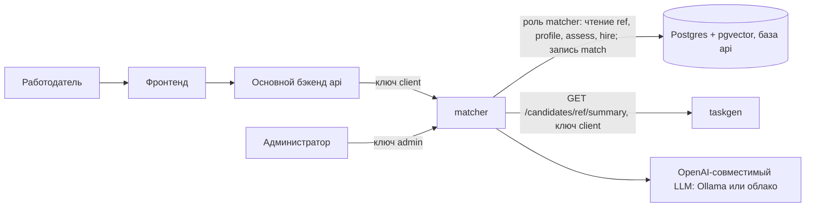
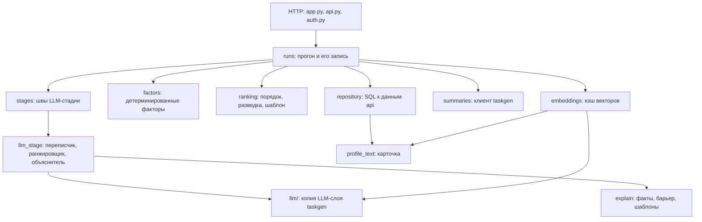
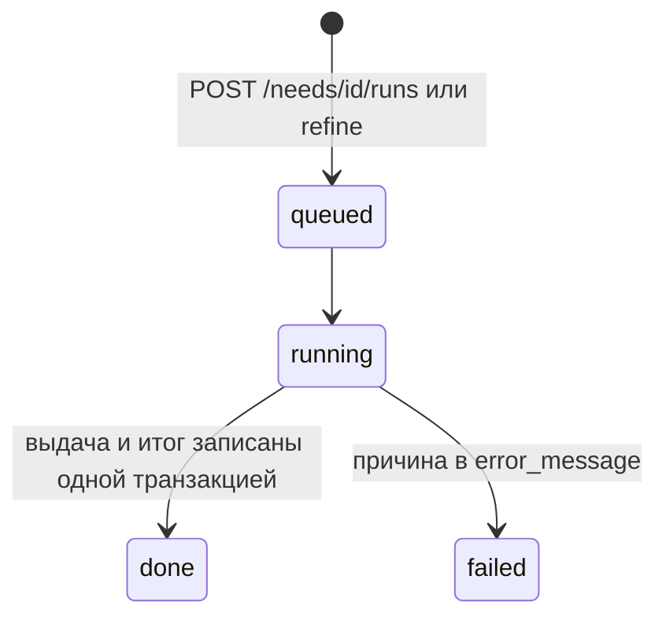

# Архитектура matcher

matcher — отдельный HTTP-сервис на FastAPI, который по потребности работодателя подбирает кандидатов: сужает пул жёсткими условиями, ищет ближайших по смыслу, оценивает короткий список и объясняет каждую строку выдачи. Что именно происходит на каждой стадии и почему — в [matching-mechanics.md](matching-mechanics.md), эндпоинты — в [generated/api.md](generated/api.md)

## Место в платформе

- Работодатель в matcher напрямую не ходит. Подбор запускает основной бэкенд ключом роли `client` и сам решает, что показать работодателю и кому открыть контакты. matcher о контактах не знает
- Роль `admin` выпускает ключи и запускает пересчёт векторов. Admin проходит любую проверку роли. Ключи хранятся в БД только SHA-256-хэшем, первый admin-ключ задаёт настройка `bootstrap_admin_key` ([generated/settings.md](generated/settings.md))
- matcher читает потребности, профили и грейды прямо из базы api, а machine summary кандидата берёт у [taskgen](../taskgen/architecture.md) по HTTP. `candidate_ref` в taskgen равен `profile.candidates.user_id`: так считают оба сервиса
- LLM нужен переписчику, ранжировщику и проверяльщику, а эмбеддер — отдельная роль. Провайдера и модель каждой роли задаёт настройка `llm` ([generated/settings.md](generated/settings.md#llm)). Без LLM подбор работает, см. [matching-mechanics.md](matching-mechanics.md#что-происходит-без-части-служб)

> [!NOTE]
> В текущем коде основного бэкенда (`api/`) вызовов matcher ещё нет. Контракт между ними — API matcher

## Данные: одна база с api

Таблицы подбора `match.*` описаны моделями и миграциями api и лежат в его базе: [Структура БД.md](../Структура%20БД.md), раздел `match`. matcher не заводит вторую копию этих таблиц и не копирует данные профилей. Он подключается к базе api под своей ролью Postgres, права которой выданы явным списком, а не на схемы целиком:

| Схема | Права роли | Зачем |
|---|---|---|
| `ref` | чтение | справочники: специализации, грейды, навыки, категории |
| `profile`, `assess`, `hire` | чтение разрешённых таблиц, у `profile.candidates` разрешённых столбцов | то, что код подбора читает: предпочтения, навыки, ФСП, репозитории GitHub, грейды, потребности |
| `match` | чтение и запись | прогоны, выдача, векторы, чат потребности |
| `matcher` | владелец | собственные таблицы сервиса: хэши ключей и версия его миграций |

Права задаёт [db-init.sql](../../matcher/db-init.sql), порядок запуска — [deployment.md](deployment.md). Что список скрывает и что остаётся доступным — [security.md](security.md#какие-данные-видит-matcher)

Почему так, а не отдельная база:

- Схема `match` уже спроектирована под конвейер подбора и принадлежит api. Копия таблиц разошлась бы с оригиналом, а пересылка профилей между базами создала бы второй экземпляр персональных данных
- Единственный источник схемы — миграции api. Матчер обращается к колонкам SQL-запросами и не держит моделей этих таблиц. Расхождение с миграциями ловят интеграционные тесты, которые гоняют подбор по настоящей схеме
- Чтение через роль с явным списком даёт защиту, которую не даёт доверие коду: сервис физически не может прочитать контакты и токены, даже если в нём найдут уязвимость

Цена выбора: схема api и код matcher связаны. Столбец, который код начал читать, нужно добавить в [db-init.sql](../../matcher/db-init.sql), иначе интеграционный тест упадёт с отказом в доступе. Таблицу api, созданную не ролью-владельцем (`fsp`), правила по умолчанию не покроют, и права на неё выдаются отдельно

## Функции и эндпоинты

| Функция | Что делает | Эндпоинты |
|---|---|---|
| Запуск подбора | Создаёт прогон по потребности и исполняет его в фоне | `POST /needs/{need_id}/runs` |
| Результат | Отдаёт статус, обзор и выдачу с разложением по факторам | `GET /runs/{run_id}` |
| Фильтры | Сужает выдачу готового прогона, ничего не пересчитывая и не записывая | `GET /runs/{run_id}/results` |
| Уточнение | Запускает новый прогон по сообщению работодателя | `POST /runs/{run_id}/refine` |
| Векторы | Досчитывает векторы изменившихся карточек в фоне | `POST /embeddings/refresh`, CLI `matcher embed` |
| Ключи | Выпускает сервисные ключи с ролью | `POST /keys` |
| Состояние | Проверка, что сервис запущен | `GET /health` |

## Компоненты

| Модуль | Что делает |
|---|---|
| [`app.py`](../../matcher/src/matcher/app.py) | Сборка приложения: настройки, соединение с БД, эмбеддер, клиент LLM, источник summary. Проверка размерности вектора при старте и подхват прогонов, не завершённых до перезапуска. Тесты подставляют подделки через аргументы `create_app` |
| [`api.py`](../../matcher/src/matcher/api.py), [`auth.py`](../../matcher/src/matcher/auth.py) | Эндпоинты, роли и ключи. Ключи по образцу [taskgen](../../taskgen/src/taskgen/auth.py), но модуль свой: он опирается на таблицу ключей сервиса |
| [`runs.py`](../../matcher/src/matcher/runs.py) | Жизненный цикл прогона и конвейер: порядок стадий, запись выдачи одной транзакцией, уточнение и сообщения чата |
| [`repository.py`](../../matcher/src/matcher/repository.py) | Все запросы к данным api: потребность, префильтр, факты и карточки кандидатов, выдача с фильтрами |
| [`factors.py`](../../matcher/src/matcher/factors.py) | Факторы соответствия и сводный `factor_score` |
| [`ranking.py`](../../matcher/src/matcher/ranking.py) | Порядок выдачи, разведка, короткий список, объяснение по шаблону. Без БД и сети |
| [`profile_text.py`](../../matcher/src/matcher/profile_text.py) | Карточка и её текст для эмбеддинга; хэш текста как ключ кэша |
| [`embeddings.py`](../../matcher/src/matcher/embeddings.py) | Кэш векторов по хэшу, проверка размерности, близость к вектору запроса |
| [`summaries.py`](../../matcher/src/matcher/summaries.py) | Клиент `GET /candidates/{ref}/summary` в taskgen |
| [`stages.py`](../../matcher/src/matcher/stages.py), [`llm_stage.py`](../../matcher/src/matcher/llm_stage.py) | Швы LLM-стадии и их реализация на LLM: переписчик, ранжировщик, проверенные объяснения |
| [`explain.py`](../../matcher/src/matcher/explain.py) | Факты объяснения, запрещённые ярлыки, промпты писателя и проверяльщика, шаблон обзора |
| [`config.py`](../../matcher/src/matcher/config.py) | Все настройки и их значения по умолчанию |
| [`cli.py`](../../matcher/src/matcher/cli.py) | Команды `matcher serve` и `matcher embed` |

LLM-стадия отделена швами `stages`: прогон знает только их протоколы, поэтому конвейер работает без LLM, а тесты подставляют свои стадии

## Жизненный цикл прогона

Прогон создаётся в статусе `queued` и исполняется в фоне. Запрос `POST /needs/{need_id}/runs` отвечает сразу, а клиент опрашивает `GET /runs/{run_id}`, пока статус не станет `done` или `failed`:

- Выдача и итог прогона пишутся одной транзакцией, поэтому у прерванного прогона выдачи нет. При старте сервис находит прогоны в `queued` и `running` и исполняет их заново
- Потребность закрыта (`is_active = false`) — запуск и уточнение отвечают 409
- Уточнение — новый прогон, а не изменение старого: прежняя выдача остаётся целой

## Копия LLM-слоя taskgen

Клиент OpenAI-совместимого API, маршрут по ролям и провайдерам, маркеры недоверенного текста, ответ модели по схеме с запасным разбором JSON, доказательство вердикта и проверка текста по фактам написаны и замерены в [taskgen](../taskgen/architecture.md). matcher нужны те же механизмы, и в его репозитории они лежат копией в [`src/matcher/llm`](../../matcher/src/matcher/llm)

Копию делает скрипт [`sync_llm.py`](../../matcher/scripts/sync_llm.py): он берёт из taskgen перечисленные модули и все модули taskgen, до которых они доходят импортами, добавляет в начало каждого файла строку о происхождении и заменяет `taskgen` на `matcher.llm` в строках импорта. Больше ничего в файлах не меняется. Копию не правят руками. Тест [`test_llm_sync.py`](../../matcher/tests/test_llm_sync.py) собирает её заново и падает, если закоммиченная копия разошлась с taskgen, а CI матчера запускается и при изменении исходников taskgen, которые копия берёт

Это второй экземпляр кода, и источник правды у него один: taskgen. Почему копия, а не общий пакет или импорт:

- Сервисы собираются и запускаются независимо, у каждого свой `pyproject.toml`, свой `uv.lock` и свой образ. Импорт `taskgen` из matcher потянул бы в образ весь taskgen с его зависимостями
- Общий пакет потребовал бы третьего проекта, версий и публикации ради нескольких файлов, которые сейчас меняются вместе с замерами в taskgen
- Копия без проверки тихо разошлась бы с источником. Скрипт и тест дают расхождению красный цвет там, где оно возникло

Если общий слой разрастётся, правильнее вынести его в пакет, чем расширять список файлов копии. Что остаётся за matcher: настройки LLM (`config.py` расширяет общую часть своими ролями), ключи и авторизация, объяснения и все промпты

## Что хранит matcher

| Где | Что | Кто пишет |
|---|---|---|
| `match.search_runs` | прогон: потребность, родитель, статус, параметры, модель, обзор, ошибка | matcher |
| `match.search_results` | строка выдачи: стадия, ранг, баллы, объяснение, разложение по факторам | matcher |
| `match.candidate_embeddings`, `match.need_embeddings` | кэш векторов с хэшем текста карточки | matcher |
| `match.chat_threads`, `match.chat_messages` | реплики уточнения: сообщение работодателя и ответ сервиса | matcher, тред при первом уточнении |
| `match.skill_relevance` | веса навыков для специализаций; matcher их читает при расчёте стека | `fspdb relevance` в api |
| `matcher.api_keys` | хэши ключей сервиса | matcher |

Назначение и ключевые поля таблиц `match` — в [Структуре БД](../Структура%20БД.md), поле `factors` — там же у `match.search_results`
