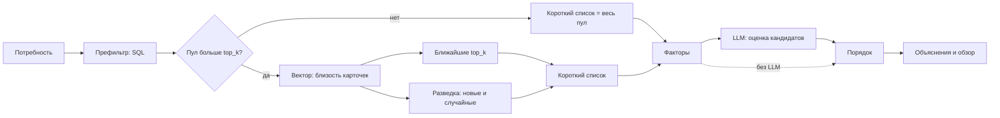

# Механика подбора и логика категоризации

Здесь описано, как matcher превращает потребность работодателя в ранжированный список кандидатов с объяснением, и почему каждая стадия устроена так. Значения настроек, пороги и веса в текст не скопированы: они живут в коде и в [generated/settings.md](generated/settings.md), а здесь названы по смыслу. Устройство сервиса — в [architecture.md](architecture.md), защита от недоверенного текста — в [security.md](security.md), проверка качества подбора — в [validation.md](validation.md)

## Что получает работодатель

Работодатель задаёт потребность в основном бэкенде: специализацию или категорию, грейд, навыки с важностью, вилку зарплаты, пожелания и негативный промт, то есть чего он не хочет. Подбор по потребности даёт список кандидатов от лучшего к худшему. У каждой строки есть три вещи:

- место в списке и итоговый балл
- разложение балла по факторам, у каждого значение и строка на русском
- объяснение для работодателя, которое проверено по этим строкам или собрано из них по шаблону

Работодатель может уточнить подбор сообщением или сузить готовую выдачу фильтрами. Прежняя выдача при этом не меняется. Направление подбора сейчас одно: потребность ищет кандидатов. Шаблон карточки и факторы симметричны, поэтому обратное направление, от кандидата к потребности, можно добавить позже без смены схемы

## Конвейер

Вектор отвечает за полноту: он не должен потерять подходящего кандидата, а порядок внутри короткого списка задают факторы и, если она включена, LLM. Поэтому векторная стадия только сужает пул до размера, который LLM оценит за разумное число вызовов, и не решает, кто лучше

## Категоризация

Категория кандидата — пара из специализации и грейда, строка справочника `ref.categories`. У категории есть статус подтверждения, и matcher его только читает:

- грейд подтверждён, если текущая запись `assess.grade_assignments` получена тестом (`source = test`). Тест проводит [taskgen](../taskgen/testing-mechanics.md), а присваивает грейд основной бэкенд
- грейд не подтверждён, если запись получена любым другим способом: назначена вручную или администратором, импортирована. Справочник способов — `GradeSource` в [enums.py](../../api/app/db/enums.py)
- специализация кандидата для подбора — специализация его текущей категории, а без категории — желаемая специализация из его предпочтений

Матчер не присваивает и не меняет грейды. Он делает одно: подтверждённый грейд всегда ставит выше неподтверждённого, без коэффициента. Это не штраф, который хороший кандидат с заявленным грейдом может перебить баллом, а порядок в два яруса: внутри яруса работают остальные ключи, между ярусами границу не пересечь. Причина в цели платформы: работодатель ищет подтверждённую категорию, и заявленный грейд не должен вытеснять проверенный

При этом неподтверждённого кандидата префильтр не отсекает. Он остаётся в выдаче ниже подтверждённых, помечен строкой фактора "Грейд" и полем `grade_confirmed` в разложении, и работодатель видит его и может отфильтровать по этому полю

## Префильтр

Префильтр — один SQL-запрос, [`_PREFILTER`](../../matcher/src/matcher/repository.py). Он отсекает только тех, кто заведомо не подходит по жёсткому условию. Остальное решают факторы, потому что отсечённый кандидат не вернётся на следующей стадии

| Условие | Что проверяет | Почему жёсткое |
|---|---|---|
| Виден в поиске | кандидат не скрыл профиль от поиска (`is_searchable`), по умолчанию виден | выбор кандидата, обойти его нельзя |
| Открыт к предложениям | `is_open_to_offers` | кандидат не хочет писем |
| Специализация | специализация кандидата совпадает со специализацией потребности; грейд не проверяется | чужая специализация не станет подходящей, а соседний грейд остаётся вариантом |
| Вилка | интервалы ожиданий кандидата и бюджета потребности пересекаются, если оба указаны в одной валюте | вилки вне пересечения не сойдутся |
| Город и формат | если связанная вакансия не удалённая и город в ней задан, кандидат живёт в нём или готов к переезду | вакансия не удалённая — значит, нужен город |

Условие не применяется, когда данных нет: потребность без специализации не отсекает по ней, кандидат без ожиданий или с ожиданиями в другой валюте проходит вилку. Формат работы, который предпочитает кандидат, не отсекает его, а работает как фильтр поверх прогона. Город и формат берутся из вакансии, связанной с потребностью, а не из потребности: схему `hire.employer_needs` matcher не меняет

## Карточка

Кандидат и потребность описываются одним шаблоном, [`render_profile`](../../matcher/src/matcher/profile_text.py). Так вектор сравнивает тексты одного вида, а не резюме с объявлением. В карточку входят:

- категория со статусом подтверждения
- подтверждённые навыки с уровнем и отдельно заявленные
- опыт работы
- текст "о себе" и позитивный промт
- репозитории GitHub, если кандидат их показывает, и результаты ФСП, если не скрыл
- machine summary из taskgen: сводка результатов тестов

Карточка кандидата собирается детерминированно из полей БД и summary, текст от LLM в неё не входит. Одни и те же данные дают тот же текст и тот же хэш, поэтому векторы кэшируются по хэшу текста и пересчитываются, только когда текст изменился. Флаги приватности действуют на карточку и на фактор ФСП вместе: скрытый GitHub или ФСП не попадёт ни в текст, ни в оценку

Негативный промт в карточку и в текст для эмбеддинга не попадает никогда. Замер taskgen показал, что bge-m3 принимает отрицание за факт: "без опыта с базами" притягивает профили с базами ([models.md](../taskgen/models.md)). Негативные промты обеих сторон идут только в LLM-стадию

## Карточка запроса

Для запроса нужна такая же карточка идеального кандидата. Она строится одним из двух способов:

- из структурных полей потребности: категория, навыки, опыт по грейду, описание и позитивный промт. Это путь без LLM
- переписчиком (HyDE): LLM по тексту потребности заполняет карточку так, как её заполнил бы сам идеальный кандидат. Категория и её статус берутся из структурной карточки, а не от модели

Вариант записывается в `params.query_variant`, а текст карточки запроса — в `params.query_profile`. Если переписчик не дал годного ответа, прогон продолжается с карточкой из полей, а причина попадает в `params.rewriter_error`. Какой вариант лучше находит кандидатов, показывает [validation.md](validation.md)

## Векторная стадия и когда её нет

Векторная стадия считает косинусную близость карточки запроса к карточкам кандидатов пула и оставляет ближайших. Число оставляемых задаёт настройка `vector.top_k`, единственная, которую стоит подбирать под размер базы

Если пул после префильтра не больше `top_k`, векторная стадия пропускается: весь пул и так помещается в короткий список. В `params` пишется `vector_skipped = true`, у строк выдачи нет `vector_score`, а стадия строки — `prefilter`. Это не упрощение: вектор нужен, чтобы сузить пул, а сужать нечего. Побочный эффект полезен: на небольшой базе подбор работает без эмбеддера вообще

Когда стадия идёт, близость считается точно по всем векторам пула, без `LIMIT` и приближённого индекса. Пул уже отфильтрован и мал, а близость остальных кандидатов нужна следу прогона: при настройке `results.store_pool` они записываются без ранга, и по ним проверяют полноту вектора. Вектор карточки запроса кэшируется по хэшу её текста в `match.need_embeddings`, векторы кандидатов — в `match.candidate_embeddings`. Кандидат без непустой карточки вектора не получает

Размерность вектора задана типом колонки в схеме api. Сервис сверяет её с моделью при старте и не стартует, если они разошлись. Модель задаёт настройка `llm.embedding`, одна для кандидатов и потребностей

## Разведка

Чистый векторный отбор повторяет себя: профиль, чья карточка ещё не набрала "правильных" слов, не попадёт в ближайшие никогда. Поэтому к ближайшим добавляется малая фиксированная доля профилей вне векторного списка:

- самые новые профили пула, у которых ещё нет истории
- случайные профили из остальных

Размеры долей — `exploration.fresh` и `exploration.random`, а ноль выключает долю. Случайный выбор воспроизводим: генератор берёт seed от `id` прогона, и тот же прогон выбрал бы тех же кандидатов. Выбранные записываются в `params.exploration`. Разведчики проходят те же факторы и LLM, что и остальные, и стоят в выдаче по общим правилам, так что слабый разведчик уйдёт вниз

## Факторы

Фактор — число от нуля до единицы и строка на русском, из которой работодатель видит причину. Факторы считает код ([`factors.py`](../../matcher/src/matcher/factors.py)), модель их не придумывает и не правит. Применим ли фактор, решает запрос: если в потребности нет навыков, стек не считается. Если у кандидата нет данных, фактор получает нейтральное значение, а не ошибку или ноль: отсутствие данных не должно ни поднимать, ни топить кандидата

| Фактор | Что означает | Применим | Как считается |
|---|---|---|---|
| `stack` | навыки потребности у кандидата | в потребности есть навыки | доля набранного веса: подтверждённый навык даёт полный вес, заявленный — часть веса, нет навыка — ноль. Вес навыка берётся из `match.skill_relevance` для специализации, желательный навык весит меньше обязательного. Подтверждённый уровень ниже нужного перекрывает заявленный: тест сильнее самооценки |
| `grade` | грейд кандидата рядом с грейдом потребности | в потребности задан грейд | значение падает с каждой ступенью расстояния в обе стороны. Расстояние считается по позициям в лестнице отрасли, а не по разности уровней |
| `salary` | ожидания кандидата рядом с бюджетом | в потребности задана вилка | доля ожиданий кандидата, которая попадает в бюджет |
| `percentile` | сила профиля среди кандидатов той же категории | всегда | процентиль силы профиля в категории; кандидат, которому не с кем сравниться, нейтрален |
| `fsp` | результат в соревнованиях ФСП | всегда | место относительно числа участников; участие без места и отсутствие данных нейтральны |
| `freshness` | давность подтверждения профиля | всегда | полная для недавно подтверждённого профиля и падающая до нуля к давнему |

Все доли и границы — константы начала [`factors.py`](../../matcher/src/matcher/factors.py), там же объяснено, зачем каждая. Сводный `factor_score` — среднее применимых факторов. Он нужен трём вещам: как порядок, когда LLM нет, как ключ для ничьих и как факт, который читают ранжировщик и проверяльщик. Это не итог подбора: с LLM порядок задаёт её оценка

Разложение хранится в `match.search_results.factors`: `grade_confirmed`, `factor_score` и `items` с значением, строкой и признаком применимости каждого фактора; если кандидата оценила модель, то ещё `llm` с попаданиями в негативные промты. Форма описана в [generated/api.md](generated/api.md) у схемы `ResultOut` и в [Структуре БД](../Структура%20БД.md#matchsearch_results)

## LLM-стадия

LLM-стадия включается настройкой `llm_stage.enabled`. Роли моделей заданы в `llm.*` и описаны в [generated/settings.md](generated/settings.md#llm)

Ранжировщик оценивает кандидатов короткого списка точечно, а не сортирует весь список: модель ставит каждому кандидату оценку по шкале, а порядок получается сравнением оценок кодом. Так оценка зависит от карточки и от небольшого батча, а не от состава всего списка. Кандидаты идут батчами по `llm_stage.batch_size`. В запросе модель видит:

- потребность вместе с уточнениями и негативным промтом работодателя
- карточку кандидата и его machine summary
- негативный промт кандидата
- строки применимых факторов, которые посчитал сервис, с пометкой, что они верны

Для каждого кандидата модель возвращает оценку от нуля до единицы, фрагменты негативного промта работодателя, которым кандидат соответствует, фрагменты негативного промта кандидата, которым соответствует потребность, и черновик объяснения. Кандидат, который попал под негативный промт работодателя, получает оценку ниже тех, кто не попал. Попадания сохраняются в `factors.llm`, но фактами для объяснения не служат: их назвала модель

Ответ проверяется по схеме. Если в нём нет кандидата, есть лишний или повторный номер, запрос повторяется с перечнем ошибок. Если после повторов ответа нет, стадия считается недоступной: прогон не падает, порядок идёт по факторам, а в `params` пишутся `llm_fallback` и причина

## Порядок выдачи

Ключи сравнения идут по убыванию важности, ничья решается идентификатором кандидата, поэтому порядок воспроизводим:

1. подтверждённый грейд выше неподтверждённого
2. оценка LLM, если она есть
3. `factor_score`
4. `vector_score`

Итоговый `final_score` строки равен оценке LLM, а без неё — `factor_score`. Эти два числа считаются по-разному, поэтому сравнивать `final_score` строк разных прогонов, особенно с LLM и без неё, нельзя; внутри одного прогона шкала одна. Фильтр `min_score` действует внутри прогона

## Объяснения и обзор

Работодатель видит только проверенный текст. Объяснение каждой строки проходит цепочку:

1. Черновик пишет ранжировщик по строкам факторов
2. Барьер кодом отклоняет текст, если в нём есть число, которого нет в строках факторов, служебный маркер, запрещённый ярлык или превышение длины колонки. Ярлыки — слова о честности кандидата, об авторстве ИИ, о возрасте и поле: подбор их не учитывает и называть не должен
3. LLM-проверяльщик разбирает каждое предложение и для подтверждённого называет доказательство: строки фактов, из которых оно следует
4. Отклонённый текст ранжировщик переписывает не больше `explanation.rewrites` раз
5. Если проверку не прошёл ни один вариант или модель недоступна, остаётся шаблон: строки применимых факторов, склеенные в текст

Шаблон тоже верен по построению: он состоит из тех строк, которые видит работодатель. Обзор прогона для `search_runs.summary` строится тем же способом по фактам прогона: размеры пула и выдачи, число кандидатов с подтверждённым грейдом и строки первых мест. Механика барьера, доказательства и переписывания общая с taskgen и пришла вместе с копией его LLM-слоя, см. [architecture.md](architecture.md#копия-llm-слоя-taskgen)

## Уточнение и фильтры

Уточнение меняет сам запрос. `POST /runs/{id}/refine` создаёт новый прогон по той же потребности с `parent_run_id`, а сообщения цепочки уточнений лежат в `params.refinements`. Переписчик и ранжировщик видят потребность и все уточнения от первого к последнему и считают уточнения важнее исходного описания. В тред чата потребности пишутся реплика работодателя и ответ сервиса со ссылкой на новый прогон. Прежний прогон остаётся целым: к любой версии выдачи можно вернуться, и видно, как работодатель сужал запрос

Фильтры не меняют запрос. `GET /runs/{id}/results` сужает выдачу готового прогона по городу, переезду, формату работы, подтверждённости грейда, навыкам, бюджету и минимальному баллу, ничего не пересчитывает и не пишет. Фильтры действуют вместе. Параметр `view` отдаёт полные строки или краткие: место и балл. Точный список фильтров и семантика отсутствия данных — в [generated/api.md](generated/api.md)

## Что происходит без части служб

| Чего нет | Что делает подбор |
|---|---|
| LLM-стадия выключена | карточка запроса из полей, порядок по подтверждённому грейду и `factor_score`, объяснение и обзор по шаблону; `llm_model` у прогона пуст |
| Переписчик не ответил | карточка запроса из полей, причина в `params.rewriter_error`, остальные стадии идут |
| Ранжировщик не ответил | порядок по факторам, в `params` `llm_fallback = true` и причина |
| Проверяльщик или писатель объяснений не ответили | объяснение или обзор по шаблону |
| Эмбеддера нет, пул не больше `top_k` | подбор идёт: векторная стадия не нужна |
| Эмбеддера нет, пул больше `top_k` | прогон завершается статусом `failed` с причиной в `error_message`: короткий список без вектора не собрать |
| taskgen недоступен | карточки без machine summary, предупреждение в журнале; кандидаты остаются в подборе |

Незавершённые прогоны после перезапуска сервис подхватывает и исполняет заново: выдачу прогон пишет одной транзакцией, поэтому у прерванного её нет

## Воспроизводимость

В `match.search_runs.params` сохраняется всё, что повлияло на прогон: размер `top_k`, вариант и текст запроса, модель эмбеддингов и хэш карточки запроса, разведка, уточнения, признаки пропуска вектора и отката LLM. В `llm_model` лежит модель ранжировщика. Порядок детерминирован при тех же данных и тех же ответах моделей. Пересчёт векторов на новых карточках меняет выдачу, и это ожидаемо: профиль изменился
