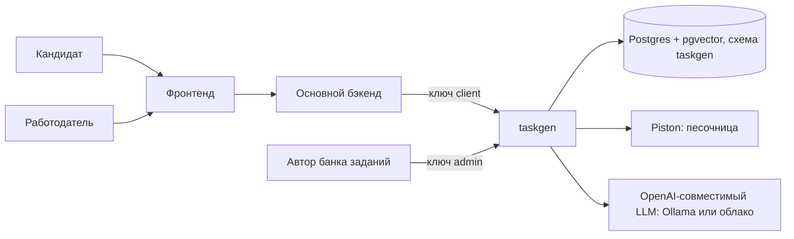
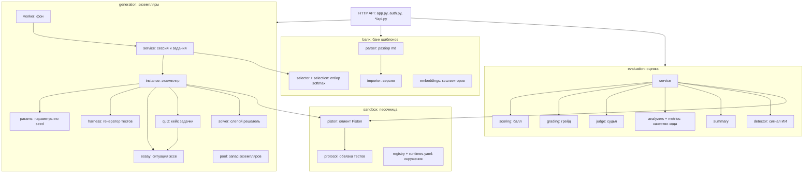
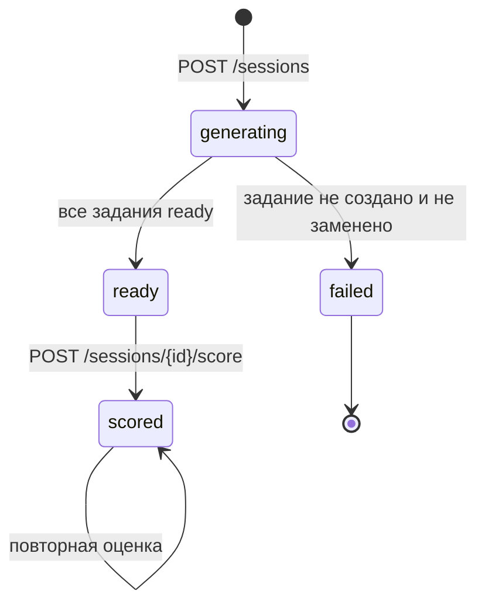
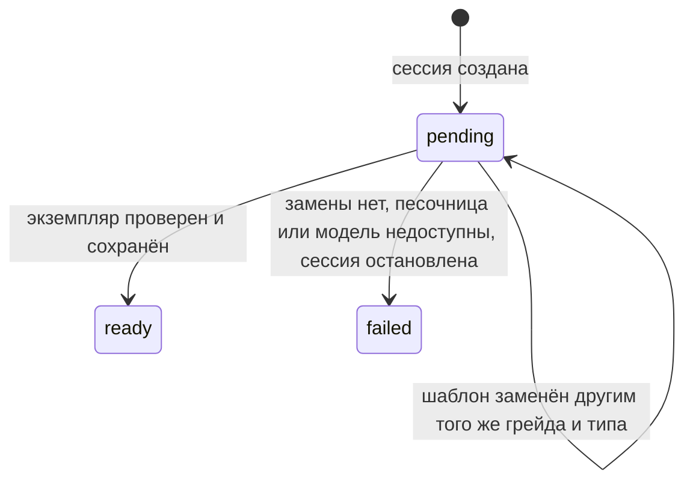
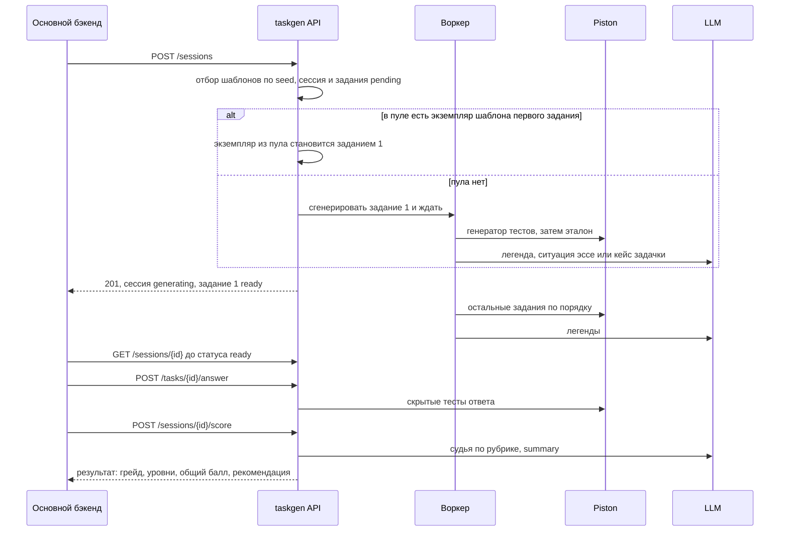

# Архитектура taskgen

taskgen — отдельный HTTP-сервис на FastAPI со своей схемой в Postgres. Он выдаёт кандидату набор заданий под заявленный грейд, проверяет каждое задание до выдачи, принимает ответы и присваивает грейд по результату. Механика заданий и её обоснование — в [testing-mechanics.md](testing-mechanics.md), эндпоинты — в [generated/api.md](generated/api.md)

## Место в платформе

- Кандидат и работодатель в taskgen напрямую не ходят. Сессии, ответы и результаты сервис получает и отдаёт основному бэкенду, который держит ключ роли `client`. Сервис знает кандидата только по `candidate_ref` — идентификатору из основного бэкенда
- Роль `admin` загружает шаблоны, выпускает ключи и может переопределить параметры отбора для одной сессии. Admin проходит любую проверку роли
- Ключи хранятся в БД только SHA-256-хэшем, первый admin-ключ задаёт настройка `bootstrap_admin_key` ([generated/settings.md](generated/settings.md))
- Профиль кандидата, категория, история грейдов и интервал смены грейда живут в основном бэкенде, их схема — [Структура БД.md](../Структура%20БД.md), раздел `assess`. taskgen возвращает результат сессии с присвоенным грейдом и рекомендацией, а решение о смене грейда принимает основной бэкенд

> [!NOTE]
> В текущем коде основного бэкенда (`api/`) вызовов taskgen ещё нет. Контракт между ними — API taskgen

## Функциональная архитектура

| Функция | Что делает | Эндпоинты |
|---|---|---|
| Банк шаблонов | Принимает md-шаблоны, проверяет их и хранит версиями, считает эмбеддинги описаний | `POST /templates`, `POST /templates/bulk`, `GET /templates`, CLI `taskgen import` |
| Тестовая сессия | Отбирает шаблоны под область, грейд и навыки кандидата, создаёт задания и генерирует их экземпляры | `POST /sessions`, `GET /sessions/{id}`, `GET /tasks/{id}` |
| Объяснимость отбора | Отдаёт режим сходства, параметры, расстояния, вероятности и замены шаблонов | `GET /sessions/{id}/selection` |
| Приём ответов | Сохраняет ответ и поведенческие сигналы, сразу прогоняет код на скрытых тестах и анализаторах | `POST /tasks/{id}/answer` |
| Оценка | Считает балл каждого задания, присваивает грейд по уровням, пишет результат | `POST /sessions/{id}/score`, `GET /sessions/{id}/result` |
| Machine summary | Перезаписывает сводку по всем оценённым сессиям кандидата | `GET /candidates/{ref}/summary` |
| Ключи | Выпускает сервисные ключи с ролью | `POST /keys` |

## Компоненты

| Модуль | Ответственность | Код |
|---|---|---|
| `contracts` | Типы и протоколы между модулями: статусы, `TemplateSpec`, `LLMClient`, `SandboxRunner`, `Judge`, `HiddenPayload`. Реализации подставляются при сборке приложения, в тестах — подделки | [contracts.py](../../taskgen/src/taskgen/contracts.py) |
| `bank` | Разбор шаблона с перечнем всех ошибок, импорт набора одной транзакцией, версии шаблонов, эмбеддинги, отбор шаблонов | [bank/](../../taskgen/src/taskgen/bank) |
| `generation` | Сессия и её задания, экземпляр задания, легенда и ситуация эссе от LLM, проверки текста, пул, фоновый воркер | [generation/](../../taskgen/src/taskgen/generation) |
| `sandbox` | Клиент Piston, обвязки тестов для Python и C++, протокол обмена с обвязкой, реестр окружений | [sandbox/](../../taskgen/src/taskgen/sandbox) |
| `evaluation` | Прогон ответа, статические анализаторы, судья по рубрике, балл, грейд, summary, детектор ИИ | [evaluation/](../../taskgen/src/taskgen/evaluation) |
| `llm` | Клиент OpenAI-совместимого API и общий ограничитель одновременных запросов к модели | [llm.py](../../taskgen/src/taskgen/llm.py) |
| `config` | Все настройки и их значения по умолчанию | [config.py](../../taskgen/src/taskgen/config.py) |

Модули обращаются к внешним сервисам только через протоколы из `contracts`. Прямые связи между модулями есть там, где одна функция нужна двоим: генерация вызывает отбор из `bank.selector`, а генерация и оценка разбирают ответы модели одним `evaluation.jsonout`

Генерация и оценка ходят в одну модель через общий ограничитель `limited_llm`: локальный сервер вроде Ollama отвечает по очереди, и без общего лимита последние запросы очереди падали бы по таймауту. Лимит задаёт `llm.concurrency`

## Жизненный цикл сессии и задания

Статусы и их смысл заданы в `SessionStatus` и `TaskStatus` в [contracts.py](../../taskgen/src/taskgen/contracts.py)

- Сессия создаётся сразу со всеми заданиями в статусе `pending`. Ответ на `POST /sessions` приходит, когда готово первое задание, остальные генерируются в фоне, и клиент получает их опросом `GET /sessions/{id}`
- Шаблон, который не дал экземпляра из-за самого шаблона или ответа модели, заменяется следующим по вероятности шаблоном того же грейда и типа из того же отбора, не больше `generation.replacements_per_task` раз на задание. Замены видны в `GET /sessions/{id}/selection`
- Недоступная песочница или модель замену не вызывает: любой шаблон упал бы так же. Тогда сессия получает `failed` с причиной, а оставшиеся задания — `failed`. Неполный набор заданий не оценивается, потому что исказил бы грейд по уровням
- Ответ принимается на задание в статусе `ready`, даже пока остальные задания сессии генерируются. Повторная отправка до оценки заменяет ответ
- Оценить можно сессию в статусе `ready` или `scored`; повторная оценка пересчитывает результат и перезаписывает summary кандидата

## Фоновый воркер и пул

Очередь генерации — сами строки `tasks` со статусом `pending`, поэтому внешний брокер не нужен, а перезапуск ничего не теряет: при старте сервис снова запускает сессии в статусе `generating`. Задача asyncio на сессию живёт в памяти процесса. Сервис рассчитан на один процесс: два процесса с общей БД сгенерировали бы одно задание дважды ([worker.py](../../taskgen/src/taskgen/generation/worker.py))

Пул держит на каждый текущий шаблон `generation.pool_size` готовых экземпляров без персонализации, проверенных эталоном так же, как экземпляр сессии. Из пула берётся только первое задание сессии, поэтому ответ на создание сессии не ждёт генерации. Экземпляр выдаётся одной сессии: строка пула удаляется в той же транзакции, где становится заданием, а параллельная выдача пропускает заблокированную строку. Экземпляр старше `generation.pool_max_age_hours` не выдаётся. Пул пополняется по таймеру и после импорта шаблонов, а пополнение уступает модель сессиям кандидатов. Сессия с явным `seed` пул не использует, иначе она не была бы воспроизводимой ([pool.py](../../taskgen/src/taskgen/generation/pool.py))

## Хранение

Всё хранится в схеме `taskgen` Postgres с расширением pgvector. Модели таблиц — [db.py](../../taskgen/src/taskgen/db.py), миграции — [alembic/versions](../../taskgen/alembic/versions), они же заполняют справочники областей, грейдов и навыков

| Таблица | Что хранит |
|---|---|
| `areas`, `grades`, `skills`, `area_skills` | Справочники. Новая область или грейд — строка данных, а не правка кода. Порядок грейдов задаёт `level` |
| `templates` | Версии md-шаблонов целиком и извлечённые из них поля для фильтров. Текущей может быть одна версия имени; экземпляры ссылаются на версию, поэтому старые версии не удаляются |
| `template_embeddings` | Кэш эмбеддинга описания по паре (шаблон, модель) с хэшем текста |
| `test_configs` | Параметры отбора для пары (область, грейд); пустое поле берётся из настроек |
| `test_sessions` | Сессия: кандидат, область, заявленный грейд, навыки, статус, объяснение отбора, результат оценки, снимок профиля и его хэш |
| `tasks` | Задание: шаблон, seed, статус, условие, публичная и скрытая части, кем сгенерировано, что из профиля повлияло на легенду, история замен |
| `pool_instances` | Готовые экземпляры пула |
| `answers` | Ответ, поведенческие сигналы, отчёт тестов, метрики анализаторов, вердикты судьи, компоненты и балл, сигнал детектора ИИ |
| `candidate_summaries` | Machine summary: одна запись на кандидата, пишет только сервис |
| `api_keys` | Хэши сервисных ключей и их роли |

- Скрытая часть задания (`tasks.hidden_payload`: кейсы, эталонный прогон, рубрика) не попадает ни в один ответ API: модели ответов её не содержат. Тело шаблона с эталоном и генератором тестов видит только роль `admin`
- Снимок профиля кандидата — персональные данные. Он нужен только генерации и удаляется, когда сессия перестаёт генерироваться; остаётся хэш, по которому `POST /sessions/{id}/profile` отмечает, что профиль изменился
