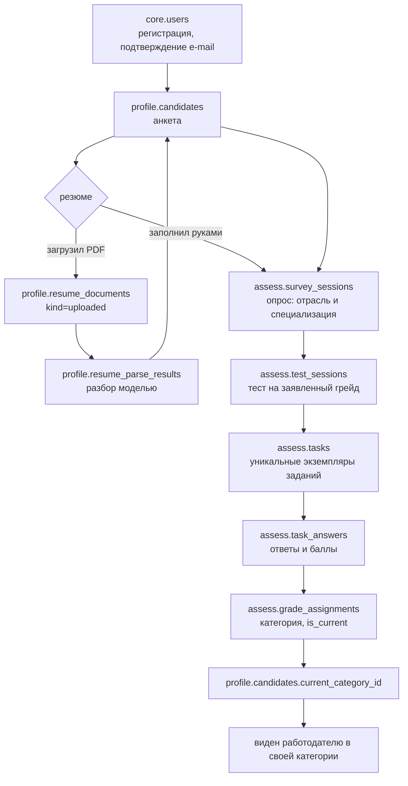
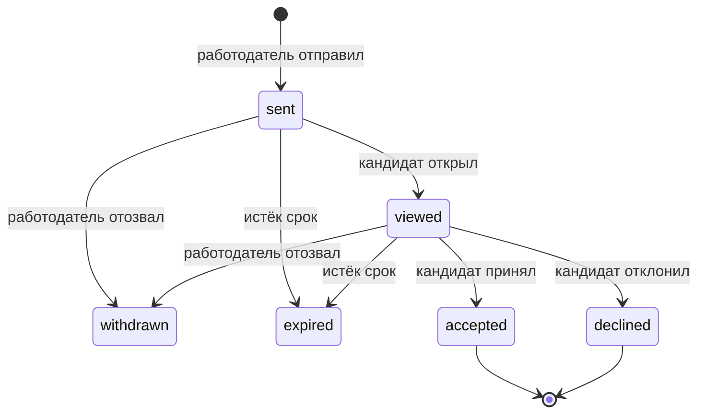

# Структура БД платформы ФСП

Построчный разбор хранилища: что за таблица, какие поля в ней ключевые, чем
ограничена и — главное — **зачем она именно такая**. Полный DDL лежит в
[[Схема БД]], журнал решений с альтернативами — в [[Решения по БД]],
диаграмма — [[ER.canvas]].

Схема живёт в `~/Projects/hackathon/db/schema.sql`: один самодостаточный файл,
применяется повторно, всё в одной транзакции.

> [!abstract] Цифры
> 62 таблицы · 182 индекса · 33 ENUM-типа · 6 схем · 0 функций · 0 триггеров

## Как это читать

Разбор идёт по схемам в порядке зависимостей: `core` → `ref` → `profile` →
`assess` → `hire` → `match`. Внутри схемы — от главной таблицы к подчинённым.
Для каждой таблицы: **Зачем** (роль в продукте), **Ключевое** (поля, ради
которых она существует), при необходимости **Почему так** (нетривиальное
решение).

---

# Принципы, общие для всей схемы

## Ключи: два типа, и это осознанно

**`uuid DEFAULT uuidv7()`** — у всего, что показывается наружу в URL:
пользователи, кандидаты, компании, вакансии, потребности, приглашения, отклики,
резюме, задания, тестовые сессии, прогоны подбора, чаты.

**`bigint GENERATED ALWAYS AS IDENTITY`** — у справочников, журналов статусов,
EAV-значений, эмбеддингов, сообщений чата, ответов.

Правило, которое легко держать в голове: **видно в URL — uuid, не видно — bigint**.

Последовательный числовой id в `/api/candidates/123` — это приглашение перебрать
базу и бесплатный замер её размера для конкурента. UUIDv7 от этого закрывает,
а в отличие от v4 упорядочен по времени, поэтому вставки ложатся в хвост
B-tree, а не разбрасываются по всему индексу.

Справочникам прятаться не от кого, им важнее компактность: `bigint` в восемь
байт против шестнадцати у uuid, и это умножается на каждый внешний ключ,
который на справочник ссылается.

> [!note] `SERIAL` в новом коде не пишем
> `GENERATED ALWAYS AS IDENTITY` — стандарт SQL. Последовательность принадлежит
> колонке, а не живёт рядом отдельным объектом, и `INSERT` с явным значением в
> identity-колонку отвергается, а не ломает молча счётчик.

## Связь 1:1 делается общим ключом

`profile.candidates.user_id` — одновременно PRIMARY KEY и FOREIGN KEY на
`core.users(id)`. Никакого суррогатного `candidates.id` рядом с `user_id` нет.

Так же устроены `hire.employers`, `profile.candidate_preferences`,
`profile.candidate_privacy`, `profile.fsp_profiles`, `profile.github_accounts`.

Выигрыш не в экономии колонки: общий PK **физически запрещает** двум профилям
кандидата указывать на одного пользователя. С отдельным суррогатом это
пришлось бы ловить дополнительным уникальным индексом и помнить про него.

## Ограничения длины — на каждом текстовом поле

PostgreSQL строго типизирован, и схема этим пользуется:

- `varchar(n)` для коротких полей; длина выбрана по смыслу, а не «на глаз»:
  `login varchar(39)` — это предел логина на стороне GitHub,
  `inn varchar(12)` — 10 или 12 цифр по закону,
  `token_hash varchar(64)` — ровно SHA-256 в hex,
  `url varchar(2048)` — практический предел адресной строки;
- `text` + `CHECK (char_length(x) <= N)` для длинных: описание вакансии 20 000,
  текст задания 20 000, ответ кандидата 50 000, извлечённый текст резюме 200 000.
  Голого `text` без потолка в схеме нет вообще;
- рядом с `NOT NULL` на названии почти всегда стоит
  `CHECK (char_length(btrim(x)) > 0)` — пустая строка и строка из пробелов не
  являются значением, а `NOT NULL` сам по себе их пропускает;
- форматы проверяются регулярками прямо в БД: e-mail, телефон
  (`^\+?[0-9]{7,15}$`), URL (`^https?://`), коды справочников
  (`^[a-z][a-z0-9_]{1,39}$`), hex-хеши токенов, ИНН, трёхбуквенный код валюты.

## Время — всегда `timestamptz`

`timestamp without time zone` в схеме не встречается ни разу. `date` — только
там, где времени нет по смыслу: дата рождения, даты проведения соревнования.

Почти везде рядом с парой моментов стоит проверка порядка:
`CHECK (finished_at IS NULL OR finished_at >= started_at)`,
`CHECK (viewed_at IS NULL OR viewed_at >= sent_at)`,
`CHECK (ends_on >= starts_on)`. Это дёшево и ловит целый класс ошибок в коде,
который пишет эти поля.

## ENUM-тип или таблица-справочник

Граница проходит по вопросу **«кто добавляет новое значение»**:

| | ENUM-тип | Таблица `ref.*` |
|---|---|---|
| Кто добавляет | программист | администратор из UI |
| Примеры | статус приглашения, статус сессии, вид ссылки, роль в чате | отрасль, специализация, грейд, навык, роль в команде |
| Цена добавления | релиз | строка в таблице |

Новый статус приглашения неизбежно означает новую ветку в коде — пусть база
такое значение и не пропустит без правки типа. Новая специализация кода не
касается вообще — значит, это данные.

ENUM-типы объявлены **в схеме своего модуля**: `hire.invitation_status`,
`assess.session_status`, `profile.link_kind`. Это требует писать `schema=` в
моделях, зато у типа сразу видна принадлежность.

## `ON DELETE` выбирается под смысл связи

- **`CASCADE`** — подчинённая запись без родителя бессмысленна: ссылки и навыки
  кандидата, ответы в сессии, события статусов, сообщения чата.
- **`RESTRICT`** — справочник нельзя удалить, пока на него ссылаются: навык,
  специализация, грейд, категория. Удаление навыка, который стоит у сотни
  кандидатов, — почти всегда ошибка оператора.
- **`SET NULL`** — факт переживает ссылку. Приглашение остаётся в кабинете
  кандидата, даже если вакансию заархивировали; событие статуса остаётся, даже
  если сотрудник уволился и его учётку удалили.

## Ни одной функции и ни одного триггера

Договорённость с командой: вся логика на бэкенде, чтобы она не оказалась
размазана по двум местам. Проверяется прямо в базе — `pg_proc` и `pg_trigger`
по нашим шести схемам пустые.

Чем заменили то, что обычно пишут триггером:

| Задача | Решение без триггера |
|---|---|
| ровно один текущий грейд у кандидата | `CREATE UNIQUE INDEX ... (candidate_id) WHERE is_current` |
| одно действующее согласие каждого вида | `CREATE UNIQUE INDEX ... (user_id, kind) WHERE revoked_at IS NULL` |
| один действующий доступ к контактам | `CREATE UNIQUE INDEX ... (candidate_id, company_id) WHERE revoked_at IS NULL` |
| пересчитать `tsvector` при изменении текста | генерируемая колонка `GENERATED ALWAYS AS (...) STORED` |
| EAV-значение должно соответствовать типу атрибута | составной FK на `(id, data_type)` + `CHECK` |
| проставить `updated_at` | **это действительно на бэкенде** — единственное, что не заменили |

> [!note] Что не считается «кодом в базе»
> Дефолты `uuidv7()` и `now()`, генерируемые колонки, `CHECK` с `char_length()` —
> встроенные механизмы PostgreSQL, а не наши хранимые объекты. Договорённость
> они не нарушают.

## Карта схем

| Схема | Отвечает за | Таблиц |
|---|---|---|
| `core` | пользователи, токены, сессии, согласия 152-ФЗ | 5 |
| `ref` | отрасли, специализации, грейды, категории, навыки, описание EAV | 11 |
| `profile` | анкета, резюме, EAV-значения, ФСП, GitHub | 16 |
| `assess` | опрос, банк заданий, тестирование, история грейдов | 12 |
| `hire` | компании, вакансии, потребности, приглашения, отклики | 11 |
| `match` | эмбеддинги, подборки, объяснимость, чат | 7 |

---

# `core` — пользователи и доступ

Пять таблиц. Всё, что относится к «кто это и имеет ли он право войти», и ничего
про предметную область.

### `core.users`

**Зачем.** Единая учётка. Роль не в колонке, а в отдельной таблице, потому что
один человек вполне может быть и кандидатом, и работодателем — например,
тимлид, который сам ищет работу и сам же нанимает.

**Ключевое.** `email citext UNIQUE` — регистронезависимая уникальность без
функционального индекса по `lower(email)`; `Ivan@mail.ru` и `ivan@mail.ru` —
один и тот же адрес, и база это понимает сама. `password_hash varchar(255)`
(argon2id укладывается в ~100 символов, запас на смену алгоритма).
`external_subject varchar(64) UNIQUE` — `sub` внешнего провайдера.

**Почему так.** `external_subject` заведён **сразу**, хотя Keycloak в MVP нет.
ТЗ говорит, что ФСП ID будет работать на базе Keycloak; когда дойдёт до
интеграции, достаточно заполнить поле, а не мигрировать таблицу пользователей
на живой базе. Под это же рассчитан `CHECK (password_hash IS NOT NULL OR
external_subject IS NOT NULL)`: пользователь из внешнего IdP приходит без
пароля, и это нормальное состояние, а не дыра.

Второй нетривиальный `CHECK`: `status <> 'active' OR email_verified_at IS NOT NULL`.
ТЗ требует регистрацию по e-mail с подтверждением адреса — здесь это не
пожелание к коду, а невозможность активировать непроверенную учётку.

### `core.user_roles`

**Зачем.** Связь «пользователь ↔ роль» (`candidate` / `employer` / `admin`) с
составным первичным ключом. Выдать вторую роль — вставить строку.

### `core.email_tokens`

**Зачем.** Одноразовые токены: подтверждение адреса и сброс пароля, различаются
полем `purpose`.

**Почему так.** Хранится `token_hash varchar(64)` — SHA-256 от токена, а не сам
токен, с проверкой формата `^[a-f0-9]{64}$`. Утечка таблицы не даёт войти ни в
один аккаунт. Это ровно тот же принцип, по которому не хранят пароли.

### `core.refresh_sessions`

**Зачем.** Refresh-токены по устройствам: `user_agent`, `ip inet`, `expires_at`,
`revoked_at`. Даёт «выйти на всех устройствах» и отзыв конкретной сессии.
Токен тоже хранится хешем. Тип `inet` вместо `varchar` — потому что PostgreSQL
умеет его валидировать и сравнивать по подсетям.

### `core.user_consents`

**Зачем.** Согласия по 152-ФЗ: на обработку персональных данных, на публикацию
профиля, на синхронизацию с реестром ФСП.

**Почему так.** Таблица **append-only**: отзыв согласия — это не `DELETE`, а
проставленный `revoked_at`. Удалив строку, мы потеряли бы доказательство, что
согласие вообще давалось, а именно его и спросят при разборе претензии.
Хранится ещё и `document_version` — редакция документа, с которой человек
согласился.

Действующее согласие каждого вида может быть только одно — партиальный
уникальный индекс `WHERE revoked_at IS NULL`.

---

# `ref` — справочники и описание EAV

Одиннадцать таблиц. Здесь живёт вся предметная таксономия — и именно поэтому
схема не знает, что работает с ИТ.

### `ref.industries`

**Зачем.** Отрасль. Точка расширения за пределы ИТ: новая отрасль — это строка
плюс свой банк заданий, без единого `ALTER TABLE`.

### `ref.specializations`

**Зачем.** Специализация внутри отрасли: Backend, Frontend, ML, DevOps, QA…

**Ключевое.** `parent_id` — self-FK, даёт подобласти: `backend` → `backend_python`,
`ml_engineer` → `ml_nlp`. `UNIQUE (industry_id, code)` — код уникален внутри
отрасли, а не глобально, чтобы «аналитик» в ИТ и «аналитик» в маркетинге не
дрались за имя.

**Почему так.** `CHECK (parent_id IS DISTINCT FROM id)` — защита от записи,
которая является родителем сама себе. `IS DISTINCT FROM`, а не `<>`, потому
что `<>` с NULL даёт NULL и `CHECK` такую строку пропустит.

### `ref.grades`

**Зачем.** Лестница грейдов внутри отрасли: Стажёр → Junior → Middle → Senior → Lead.

**Ключевое.** `level smallint` — числовой порядок, по нему сравнивается «грейд
ниже / выше», и ТЗ прямо требует возможности пройти тест на соседний уровень.
`UNIQUE (industry_id, level)` не даёт двум грейдам занять одну ступень.

**Почему так.** `cooldown_days smallint DEFAULT 90` живёт **здесь, а не в коде**.
ТЗ оставляет интервал смены грейда на усмотрение команды («например, не чаще
одного раза в три месяца»). Если это константа в бэкенде, её смена — релиз;
если строка в справочнике — правка значения. Заодно разные грейды могут иметь
разный кулдаун: подняться со стажёра логично разрешать чаще, чем с сеньора.

### `ref.categories`

**Зачем.** **Категория из ТЗ** — связка специализации и грейда, «бэкенд-разработчики
с опытом», «фронтенд до года». Это то, что видит и по чему ищет работодатель.

**Почему так.** Категория сделана отдельной сущностью, а не парой колонок
`(specialization_id, grade_id)` в каждой таблице. Иначе на неё нельзя сослаться
одним внешним ключом, а ссылаются четверо: кандидат, вакансия, результат теста
и выдача подбора. Плюс появляется место для `slug` (`backend.middle`) и флага
`is_active`, которым категорию выводят из оборота, не трогая справочники.

В справочниках сидит полное декартово произведение специализаций и грейдов
своей отрасли — 85 категорий.

### `ref.skill_areas`

**Зачем.** Области навыков — ровно те, что называла команда: ML, Web, DevOps,
SoftSkills, плюс данные, мобильная разработка, тестирование. `parent_id` даёт
подобласти: Web → Web/Backend, Web/Frontend.

### `ref.skills`

**Зачем.** Сам навык. `kind` разделяет язык, фреймворк, инструмент, практику и
soft-skill — в интерфейсе это разные поля внутри одной области, как и
задумывалось («в каждой области можно указать ЯП, скилл, инструмент»).

**Ключевое.** `code` уникален глобально, а не внутри области: на него ссылаются
сиды, синонимы и банк заданий, и глобальная уникальность избавляет от
составных ключей в каждом таком месте.

### `ref.skill_aliases`

**Зачем.** Синонимы: «Постгрес», «psql», «PostgreSQL», «постгря» → один
`skill_id`. Нужны ровно в двух местах: разбор загруженного PDF-резюме и
нормализация того, что возвращает LLM.

**Почему так.** `alias citext UNIQUE` — регистр не важен, и это снимает с
бэкенда всю нормализацию перед поиском совпадения.

### `ref.specialization_skills`

**Зачем.** Вес навыка в специализации (`weight`, `is_core`). Вход для
**префильтра** подбора: прежде чем считать эмбеддинги, нужно понять, кого
вообще рассматривать.

### `ref.team_roles`

**Зачем.** Роль в команде — разработчик, тимлид, архитектор, ментор, ревьюер.
ТЗ перечисляет «стек, грейд, роль в команде, формат работы» как отдельные
измерения, и роль не сводится к специализации: ментором может быть и бэкендер,
и тестировщик.

## EAV: гибкость без потери типизации

### `ref.attribute_defs` и `ref.attribute_options`

**Зачем.** Описание полей, которых нет в фиксированных колонках. Фиксированные
колонки покрывают то, что одинаково для любой отрасли (ФИО, стаж, формат
работы); всё отраслевое описывается здесь.

Это прямой ответ на идею команды «загрузить банк задач другой области и
донастроить под другую нишу». Без EAV каждая новая ниша требовала бы
`ALTER TABLE`; с голым `jsonb` исчезли бы и схема, и любая проверка.

**Ключевое.** `scope` (кандидат / вакансия / компания / задание), `code`,
`data_type`, `is_multi`, `is_public`, и `industry_id` — `NULL` означает
«атрибут общий для всех отраслей».

**Почему так — главный трюк схемы.** Классическая беда EAV в том, что значение
может не соответствовать объявленному типу атрибута, и ловить это приходится в
коде. Здесь это закрыто декларативно:

```sql
-- в attribute_defs
CONSTRAINT attribute_defs_id_type_uq UNIQUE (id, data_type)

-- в таблице значений
CONSTRAINT cav_attribute_fk FOREIGN KEY (attribute_id, data_type)
    REFERENCES ref.attribute_defs (id, data_type) ON DELETE CASCADE
```

Таблица значений хранит `data_type` у себя и ссылается **составным** ключом на
пару «атрибут + его тип». Подменить тип невозможно: такой пары просто нет в
`attribute_defs`. Дальше `CHECK` по `data_type` требует заполнить ровно
соответствующую колонку значения, а второй `CHECK` запрещает заполнить больше
одной.

У `attribute_options` ровно по той же причине стоит избыточный на вид
`UNIQUE (attribute_id, id)`: он позволяет значению сослаться составным ключом
`(attribute_id, option_id)` и гарантировать, что выбранный вариант принадлежит
**этому** атрибуту, а не какому-то другому.

Проверено: вставка строкового значения в атрибут типа `option` падает на
`cav_attribute_fk`.

---

# `profile` — кандидат

Шестнадцать таблиц: анкета, резюме, EAV-значения, достижения ФСП, сигналы GitHub.

### `profile.candidates`

**Зачем.** Анкета. Самая широкая таблица схемы — 19 колонок, и это сознательно:
ФИО, контакты, город, формат работы, стаж, готовность к релокации — поля,
которые читаются **всегда вместе** при открытии профиля, и разносить их по
таблицам значило бы джойнить на каждый чих.

**Ключевое.**

- `user_id` — PK и FK одновременно (см. [принцип 1:1](#Связь%201%3A1%20делается%20общим%20ключом));
- `experience_months smallint CHECK (0..840)` — месяцы, а не годы: 70 лет как
  верхняя граница здравого смысла, и дробного стажа не бывает;
- `current_category_id` — текущая категория;
- `profile_strength numeric(5,2) CHECK (0..100)` — «сила подтверждённого профиля»,
  по которой ТЗ требует ранжировать внутри категории;
- `profile_refreshed_at` — когда профиль последний раз подтверждался регулярным
  заданием; это «свежий сигнал о кандидате» из ТЗ;
- `search_vector tsvector GENERATED ALWAYS AS (...) STORED` — полнотекстовый
  индекс по ФИО, городу и тексту «о себе».

**Почему так.** `current_category_id` — **денормализация**, и это осознанный
размен. Источник истины — запись в `assess.grade_assignments` с `is_current`;
колонка здесь нужна, чтобы выдача по категории была одним индексным обращением,
а не джойном на историю грейдов при каждом поиске. Цена: бэкенд обязан менять
оба места в одной транзакции, и это записано в README.

`search_vector` — генерируемая колонка, а не триггер. PostgreSQL сам
пересчитывает её при любом UPDATE, и это единственный способ держать
полнотекст в актуальном состоянии, не нарушив договорённость «без триггеров».

`birth_date` ограничена диапазоном `1930-01-01 … 2020-01-01`. Жёсткие даты, а
не `now()`, потому что `CHECK` требует иммутабельного выражения — функции
текущего времени в нём запрещены.

### `profile.candidate_links`

**Зачем.** Соцсети и **отдельная ссылка на сайт-портфолио** — именно так и
просила команда. `kind` различает github / gitlab / telegram / portfolio /
linkedin / habr / other.

**Ключевое.** `CHECK (url ~ '^https?://[^[:space:]]{3,}$')` — в поле нельзя
положить `javascript:` или мусор; `is_public` — показывать ли ссылку
работодателю.

### `profile.candidate_skills`

**Зачем.** Навыки кандидата. **Два уровня вместо одного** — это главное в
таблице:

- `self_level` — что кандидат заявил сам;
- `confirmed_level` — что подтвердилось тестом, `NULL` если не проверялось.

ТЗ строит всю механику на различии между самоописанием и подтверждённым
профилем, и схема обязана это различать физически, а не договорённостью.
`source` (`self` / `resume` / `test` / `github` / `fsp`) говорит, откуда поле
вообще взялось: из анкеты, из разбора PDF, из теста или из индексации
репозиториев.

### `profile.candidate_team_roles`

**Зачем.** Связь кандидата с ролями в команде, многие-ко-многим.

### `profile.candidate_preferences`

**Зачем.** Чего кандидат хочет: желаемая специализация, вилка, и —
**позитивный и негативный промты** свободным текстом.

**Почему так.** Промты вынесены в отдельную таблицу 1:1, а не в `candidates`,
потому что читаются они только конвейером подбора: идут в эмбеддинг и в
контекст LLM. При открытии профиля они не нужны, а строка `candidates` и так
широкая.

### `profile.candidate_privacy`

**Зачем.** Что кандидат разрешает показывать: `is_searchable`, `show_contacts`,
`show_salary`, `show_fsp`, `show_github`.

**Почему так.** `show_contacts = true` **не означает**, что контакты видно.
Это согласие кандидата в принципе; фактический доступ даёт
`hire.contact_disclosures`. Два независимых условия: кандидат не против —
и у работодателя есть основание.

### `profile.candidate_attribute_values`

**Зачем.** Значения EAV-атрибутов. Типизированные колонки
`value_string / value_text / value_integer / value_decimal / value_boolean /
value_date / option_id` плюс `data_type`.

**Ключевое.** Три ограничения вместе: составной FK на `(attribute_id, data_type)`,
`CHECK` соответствия колонки типу, `CHECK` на ровно одно заполненное значение.
Плюс `UNIQUE NULLS NOT DISTINCT (candidate_id, attribute_id, option_id)` —
`NULLS NOT DISTINCT` (появилось в PG15) нужно, чтобы для не-option атрибута,
где `option_id IS NULL`, второе значение того же атрибута было невозможно;
обычный `UNIQUE` считает NULL-ы различными и пропустил бы дубликаты.

### `profile.resume_documents`

**Зачем.** И загруженное кандидатом PDF (`kind = 'uploaded'`, распознаётся), и
сгенерированный платформой стандартизированный профиль (`kind = 'generated'`).
ТЗ требует обоих.

**Ключевое.** `storage_key` — ключ в файловом хранилище, не сам файл: держать
бинарники в базе дорого и неудобно для бэкапов. `raw_text` — извлечённый текст,
вход и для парсинга, и для эмбеддинга. `size_bytes CHECK (<= 20971520)` —
потолок 20 МБ на уровне схемы.

### `profile.resume_parse_results`

**Зачем.** Результат разбора резюме моделью: `payload jsonb`, `model`,
`confidence`, `applied_at`.

**Почему так.** Отдельно от документа — чтобы разбор можно было **переиграть**
другой моделью, не теряя ни исходник, ни предыдущую версию извлечённых полей.
`applied_at IS NULL` означает «разобрано, но кандидат ещё не подтвердил
перенос в анкету»: автораспознавание не должно молча переписывать то, что
человек ввёл руками.

## ФСП

### `profile.fsp_profiles`

**Зачем.** Связь кандидата с участником реестра ФСП.

**Почему так — важное.** Строка существует **у каждого** кандидата. Отсутствие
истории ФСП — это `verification_status = 'unlinked'`, а не отсутствие записи.

ТЗ отдельно оговаривает: «обязательна только корректная обработка случая, когда
истории ФСП у кандидата нет». Если бы строки не было, каждый запрос к профилю
требовал бы `LEFT JOIN` с разбором NULL-ов на стороне кода, и рано или поздно
кто-нибудь написал бы `INNER JOIN` и потерял половину кандидатов из выдачи.
Явный статус делает «нет истории» нормальным значением, а не краевым случаем.

`raw_payload jsonb` хранит ответ реестра как есть: структуру данных ФСП нам не
дали, и когда она появится, разбирать её будем из сохранённого сырья, а не
запрашивать заново.

### `profile.fsp_events` и `profile.fsp_achievements`

**Зачем.** Соревнования и результаты кандидата в них: место, число участников,
команда, балл, уровень события (`local` / `regional` / `federal` / `international`).

**Ключевое.** `UNIQUE (candidate_id, event_id)` — одно достижение на событие.
`CHECK (place <= participants)` — третье место из двух не бывает.
Уровень события и место — именно то, из чего бэкенд считает вклад ФСП в
`profile_strength`.

## GitHub

### `profile.github_accounts`

**Зачем.** Привязка аккаунта и установки GitHub App для индексации репозиториев.

**Ключевое.** `login varchar(39)` — предел на стороне GitHub, с проверкой
формата регуляркой. `access_token_enc bytea` — токен хранится **зашифрованным
приложением**; база видит шифротекст и ключа не знает.

### `profile.github_repos`, `github_repo_languages`

**Зачем.** Проиндексированные репозитории и разбивка по языкам в байтах.
`commits_by_owner` отделяет собственный вклад от форка с чужой историей —
без этого звёздный форк чужого проекта выглядел бы как достижение.

### `profile.github_signals`

**Зачем.** Вывод индексации: «по репозиториям видно владение навыком X на
уровне Y», с `evidence jsonb` — на чём именно основан вывод.

**Почему так.** Отдельная таблица, а не прямая запись в `candidate_skills`:
сигнал пересчитывается при каждой переиндексации, а заявленный кандидатом
уровень при этом трогать нельзя. Бэкенд читает отсюда и обновляет
`candidate_skills` со `source = 'github'`, оставляя `self`-строки нетронутыми.

---

# `assess` — опрос, тестирование, грейд

Двенадцать таблиц. Здесь решается самая содержательная задача ТЗ: как
протестировать всех сопоставимо, но разными заданиями.

> [!important] Шаблон ≠ экземпляр
> Единый набор заданий утечёт, а чисто случайная генерация не даёт сопоставимой
> сложности. Схема разводит два понятия и забирает от каждого нужное свойство:
>
> **`task_templates`** несёт специализацию, грейд, сложность, ожидаемое время и
> рубрику проверки → отсюда **сопоставимость** кандидатов между собой.
> **`tasks`** — уникальный экземпляр, сгенерированный под конкретного человека
> → отсюда **устойчивость к утечке**.
>
> Утёкший экземпляр не обесценивает шаблон. Шаблон целиком кандидату не
> показывается никогда.

## Опрос

### `assess.survey_templates`, `survey_questions`, `survey_options`

**Зачем.** Входной опрос по отрасли и специализации — первый шаг пути кандидата
по ТЗ.

**Почему так.** У варианта ответа (`survey_options`) есть `specialization_id` и
`skill_id`. Вариант не просто текст — он **ведёт** на специализацию или навык,
и опрос за счёт этого превращается в предварительную классификацию ещё до
теста. Без этих полей бэкенду пришлось бы зашивать соответствие «ответ →
специализация» в код, и опрос перестал бы быть данными.

### `assess.survey_sessions`, `survey_answers`

**Зачем.** Прохождение опроса: что выбрал кандидат, какая специализация
получилась, на какой грейд он претендует (`claimed_grade_id`).

**Ключевое.** `UNIQUE NULLS NOT DISTINCT (session_id, question_id, option_id)` —
для одиночного выбора и свободного ответа (`option_id IS NULL`) ответ на вопрос
может быть только один, для множественного — по строке на вариант. Одно
ограничение покрывает оба формата.

## Банк заданий

### `assess.task_templates`

**Зачем.** Калиброванный шаблон задания. **Сменная часть системы**: чтобы
запустить платформу в другой нише, меняется содержимое этой таблицы, а не DDL.

**Ключевое.**

- `specialization_id` + `grade_id` — под кого задание, привязка к `ref`, а не к
  константам в коде;
- `difficulty smallint CHECK (1..10)` и `expected_minutes` — из них собирается
  тест заданной длительности и сложности;
- `generator_prompt` — промт, по которому LLM порождает экземпляр;
- `grading_rubric` — рубрика проверки с разбалловкой;
- `usage_count`, `avg_score` — накопленная статистика калибровки.

**Почему так.** Пара «промт генератора + рубрика» — это и есть ответ на вопрос
жюри «чем обеспечена сопоставимость при разных заданиях». Сложность и критерии
фиксированы в шаблоне, варьируется только формулировка. `avg_score` по
накопленным прохождениям показывает **дискриминативность**: шаблон, на котором
все получают максимум, не разделяет сильных и слабых и подлежит замене.

### `assess.tasks`

**Зачем.** Сгенерированный экземпляр под конкретного кандидата.

**Ключевое.** `candidate_id`, `statement` (сам текст), `payload jsonb`
(варианты, тест-кейсы), `answer_key jsonb` (эталон), `generated_by` (какая
модель), `generation_seed`.

**Почему так.** `answer_key` лежит в той же строке, но отдавать его клиенту
нельзя — выборка полей делается на бэкенде, и это помечено `COMMENT` прямо в
схеме, чтобы не забылось при написании сериализатора.

`generation_seed` сохраняется, чтобы генерацию можно было воспроизвести при
разборе спорного результата.

## Прохождение теста

### `assess.test_sessions`

**Зачем.** Попытка сдать тест на заявленный грейд.

**Ключевое.** `claimed_grade_id` — **заявленный** грейд (тест проверяет именно
его), `assigned_category_id` — что получилось в итоге, `outcome`
(`passed` / `failed` / `downgraded` / `upgraded`).

**Почему так.** Разделение «заявил» и «получил» — требование ТЗ: грейд не
понижается принудительно, не сдавший может пройти тест на уровень ниже, а
уверенно сдавший — подняться. Без двух полей эту механику не выразить.

`CHECK (status <> 'scored' OR (outcome IS NOT NULL AND total_score IS NOT NULL))` —
сессия не может считаться оценённой без результата и балла.

### `assess.test_session_tasks`

**Зачем.** Состав теста: какие экземпляры заданий, в каком порядке, с какими
весами.

**Почему так.** `UNIQUE (task_id)` — **один экземпляр задания не может попасть в
две сессии**. Это и есть техническая гарантия того, что задания не
переиспользуются между кандидатами; нарушить её из кода невозможно.

### `assess.task_answers`

**Зачем.** Ответ на задание с оценкой.

**Ключевое.** `checked_by` (`auto` / `llm` / `human`) — кто проверял; `feedback` —
что сказал проверяющий. И три античит-сигнала: `time_spent_sec`, `paste_count`,
`focus_lost_count`.

**Почему так.** Сигналы честности в схеме, потому что ТЗ оценивает
«устойчивость механики к распространению заданий» (25 % итогового балла).
Ответ, вставленный из буфера за восемь секунд после трёх переключений вкладки,
выглядит иначе, чем набранный за двадцать минут, — и это должно быть видно в
данных, а не только в логах фронтенда.

### `assess.grade_assignments`

**Зачем.** История присвоения категорий. Append-only.

**Ключевое.**

```sql
CREATE UNIQUE INDEX grade_assignments_current_uq
    ON assess.grade_assignments (candidate_id) WHERE is_current;
```

Два «текущих» грейда у одного кандидата физически невозможны.

`next_change_allowed_at timestamptz NOT NULL` — когда разрешена следующая смена.
Бэкенд заполняет его из `ref.grades.cooldown_days` и сравнивает с `now()`
перед выдачей новой тестовой сессии. Так требование «не чаще одного раза в три
месяца» становится данными, а не константой в коде.

`CHECK (source <> 'test' OR test_session_id IS NOT NULL)` — присвоение по
результату теста обязано ссылаться на сессию. Ручное присвоение админом
(`source = 'manual'`/`'admin'`) ссылки не требует, но и не выдаёт себя за тест.

> [!warning] Смена грейда — одна транзакция
> Партиальный уникальный индекс не даст вставить вторую текущую запись, пока не
> снят флаг у предыдущей. Поэтому порядок жёсткий:
> `UPDATE ... SET is_current = false WHERE candidate_id = ? AND is_current`,
> затем `INSERT`, затем `UPDATE profile.candidates SET current_category_id = ...` —
> всё в одной транзакции.

### `assess.regular_assignments`

**Зачем.** Регулярные короткие задания «от работодателя»: система периодически
предлагает кандидату задачу, результат поддерживает профиль свежим.

**Ключевое.** `company_id` — от кого задание (nullable: может быть и от
платформы), `status` (`issued` → `viewed` → `answered` → `scored`, либо
`expired` / `skipped`), `due_at`.

**Почему так.** Внешний ключ на `hire.companies` добавляется `ALTER TABLE`
в разделе `hire`, потому что схема `assess` создаётся раньше. Единственное
место в файле, где связь замыкается не сразу, — и это помечено комментарием.

---

# `hire` — работодатель, вакансии, приглашения

Одиннадцать таблиц. Смысловой центр продукта — приглашение: инициативу
проявляет работодатель, а не кандидат.

### `hire.companies`

**Зачем.** Профиль компании: описание, направление деятельности, контакты.

**Ключевое.** `inn varchar(12)` с `CHECK (inn ~ '^[0-9]{10}$' OR inn ~ '^[0-9]{12}$')` —
10 цифр у юрлица, 12 у ИП. `is_verified` — задел под механизм защиты от
недобросовестных работодателей, который ТЗ выносит за рамки MVP: поле есть,
логики пока нет.

### `hire.employers`

**Зачем.** Сотрудник компании как пользователь. PK = FK на `core.users(id)`.
`is_owner` отличает владельца профиля компании от рядового рекрутера.

### `hire.vacancies`

**Зачем.** Опубликованная вакансия. По ТЗ это **дополнительный** сценарий:
основная механика работает и без публикации.

**Ключевое.**

```sql
salary_min integer NOT NULL CHECK (salary_min > 0 AND salary_min <= 100000000),
salary_max integer NOT NULL CHECK (salary_max > 0 AND salary_max <= 100000000),
CONSTRAINT vacancies_salary_range CHECK (salary_max >= salary_min)
```

Пункт 2.2.1 ТЗ: «уровень заработной платы указывается обязательно — и в
вакансии, и в приглашении кандидату (диапазон "от–до", в рублях)». Здесь это
`NOT NULL`, а не валидация формы: вакансию без вилки нельзя создать никаким
способом, включая прямой `INSERT` из консоли.

`search_vector` — генерируемый tsvector по заголовку и описанию.
`CHECK (status <> 'published' OR published_at IS NOT NULL)` — опубликованная
вакансия обязана иметь дату публикации.

### `hire.vacancy_skills`

**Зачем.** Требуемые навыки: `importance` (`required` / `nice_to_have`) и
`min_level`.

### `hire.employer_needs`

**Зачем.** **Описание потребности** — вход конвейера подбора. Работодатель
описывает, кто нужен и чем занимается команда, и получает подборку.

**Почему так — ключевое отличие от доски объявлений.** Потребность существует
**отдельно от вакансии** (`vacancy_id` nullable). Работодатель может вообще
ничего не публиковать: описал потребность → получил подборку → написал
конкретному человеку. Именно эту механику ТЗ называет смысловым центром
конкурса.

`positive_prompt varchar(2000)` и `negative_prompt varchar(2000)` — свободные
предпочтения, идут в эмбеддинг и в системный промт LLM-отбора.

### `hire.need_skills`

**Зачем.** Навыки потребности, та же структура, что у `vacancy_skills`.
Отдельная таблица, потому что потребность живёт без вакансии.

### `hire.invitations`

**Зачем.** Выход работодателя на контакт с конкретным кандидатом. **Главная
таблица продукта.**

**Ключевое.**

- `vacancy_id` **nullable**, `ON DELETE SET NULL`;
- `salary_min`, `salary_max` — `NOT NULL`, как и в вакансии;
- `contact_method` (`email` / `phone` / `telegram` / `platform`) + `contact_value`;
- `status`: `sent` → `viewed` → `accepted` / `declined`, плюс `withdrawn`, `expired`;
- `sent_at`, `viewed_at`, `responded_at`, `decline_reason`.

**Почему так.** Прямая цитата ТЗ: приглашение направляется «без обязательной
привязки к опубликованной вакансии» — отсюда nullable `vacancy_id`.
`SET NULL`, а не `CASCADE`: приглашение — состоявшийся факт переписки двух
людей, архивация вакансии не должна стирать его из кабинета кандидата.

Два содержательных `CHECK`:

```sql
-- финальный статус обязан иметь момент ответа
CHECK (status NOT IN ('accepted','declined') OR responded_at IS NOT NULL)
-- если связь не через платформу, контакт должен быть указан
CHECK (contact_method = 'platform' OR char_length(btrim(coalesce(contact_value,''))) > 0)
```

Второй закрывает ТЗ-требование «приглашение содержит способ связи»: выбрать
«по телефону» и не указать телефон нельзя.

### `hire.invitation_events`

**Зачем.** Журнал смены статусов: кто, когда, с какого на какой.

**Почему так.** ТЗ требует, чтобы «обе стороны видели актуальный статус по
своим записям». Текущий статус лежит в `invitations.status`, но без журнала
нельзя ответить «когда именно просмотрели» и «кто отозвал». `CHECK
(from_status IS DISTINCT FROM to_status)` не даёт записать событие,
в котором ничего не изменилось.

### `hire.applications`, `application_events`

**Зачем.** Самостоятельный отклик кандидата на вакансию — дополнительный
функционал (7 % оценки по ТЗ): сценарий, в котором кандидат, ещё не получивший
приглашений, сохраняет возможность проявить инициативу.

`UNIQUE (vacancy_id, candidate_id)` — один отклик на вакансию.

### `hire.contact_disclosures`

**Зачем.** Кому и на каком основании раскрыты контакты кандидата.

**Почему так — правило ТЗ как строка в БД.** «Работодатель не видит контактные
данные кандидата до момента, когда кандидат принял приглашение или откликнулся
сам». Это можно было сделать `if`-ом в хендлере. Сделано таблицей, потому что:

- условие сформулировано как **событие с причиной**, а не как флаг;
- при разборе претензии по 152-ФЗ нужно показать, **кто, когда и почему**
  получил доступ — флаг этого не хранит;
- на демо это проверяется одним `SELECT`, а не чтением кода.

```sql
CONSTRAINT contact_disclosures_source_matches_reason CHECK (
       (reason = 'invitation_accepted' AND invitation_id IS NOT NULL AND application_id IS NULL)
    OR (reason = 'application_sent'    AND application_id IS NOT NULL AND invitation_id IS NULL)
)
```

Причина и ссылка обязаны совпадать, и заполнена ровно одна из двух. Вместо
полиморфного `source_id`, по которому нельзя поставить внешний ключ, — две
типизированные ссылки с проверкой.

Партиальный `UNIQUE (candidate_id, company_id) WHERE revoked_at IS NULL` —
один действующий доступ на пару «кандидат — компания».

Проверка на демо-данных: из шести кандидатов «ТехноЛайн» видит телефон двоих —
Ковалёвой (приняла приглашение) и Волковой (откликнулась сама). Остальные
четверо — «основания нет».

---

# `match` — подбор и чат

Семь таблиц. Конвейер: **префильтр → эмбеддинг → LLM**, с сохранением следа на
каждой стадии.

### `match.candidate_embeddings`, `vacancy_embeddings`, `need_embeddings`

**Зачем.** Векторные представления кандидата, вакансии и потребности.

**Ключевое.** `embedding vector(1024)` — под multilingual-e5-large / bge-m3
(русский + английский). `model varchar(60)` — какой моделью посчитано,
`source_hash varchar(64)` — хеш исходного текста. HNSW-индекс по
`vector_cosine_ops`.

**Почему три таблицы, а не одна полиморфная.** Полиморфная `embeddings(owner_kind,
owner_id, ...)` не даёт поставить внешний ключ. Без него осиротевшие вектора
накапливаются молча: кандидата удалили, его эмбеддинг остался и продолжает
всплывать в выдаче. Три таблицы с нормальными FK и `ON DELETE CASCADE` решают
это бесплатно.

**Зачем `source_hash`.** Не пересчитывать вектор, если текст профиля не
менялся. Эмбеддинги — самая дорогая часть конвейера.

> [!warning] HNSW подхватывается не всегда
> Индекс работает, только если вектор для сравнения — константа, параметр
> запроса или **скалярный подзапрос**. Если вектор приходит из `JOIN`,
> планировщик молча уходит в `Seq Scan` — без ошибки, без предупреждения.
>
> ```sql
> -- Seq Scan: вектор из JOIN
> SELECT ce.candidate_id FROM match.candidate_embeddings ce, match.need_embeddings ne
> WHERE ne.need_id = :need ORDER BY ce.embedding <=> ne.embedding LIMIT 5;
>
> -- Index Scan using candidate_embeddings_hnsw_idx
> SELECT candidate_id FROM match.candidate_embeddings
> ORDER BY embedding <=> (SELECT embedding FROM match.need_embeddings WHERE need_id = :need)
> LIMIT 5;
> ```
>
> Проверено `EXPLAIN` на развёрнутой базе. На шести демо-строках разницы не
> видно, на тысяче резюме будет.

### `match.search_runs`

**Зачем.** Один прогон подбора по потребности.

**Ключевое.** `params jsonb` — фактические пороги, размер пула, доля случайных
резюме; `strategy`; `llm_model`; `summary` — обзор подборки от LLM, который
работодатель обсуждает в чате; **`parent_run_id`** — ссылка на предыдущий
прогон.

**Почему так.** ТЗ требует «фильтрацию и уточнение запроса без потери ранее
полученной подборки». Поэтому уточнение из чата **порождает новый прогон**,
а не `UPDATE` существующего. История подбора остаётся целой, к любой версии
выдачи можно вернуться, и видно, как именно работодатель сужал запрос.

`params jsonb` сохраняется ради воспроизводимости: без него через неделю не
скажешь, почему выдача была такой.

### `match.search_results`

**Зачем.** Кандидаты в прогоне с оценками и объяснением.

**Ключевое.** `stage` (`prefilter` / `vector` / `llm`) — до какой стадии
конвейера дошёл кандидат; `vector_score`, `llm_score`, `final_score`;
`explanation varchar(2000)`.

**Почему так.** Три отдельных балла, а не один итоговый: ТЗ требует
«обоснованности ранжирования и объяснимости выдачи», и при разборе нужно
видеть, векторная близость подвела или LLM. Стадия показывает, где кандидат
отсеялся, — это и есть материал для собственной процедуры валидации, которую
ТЗ просит описать и привести результаты.

```sql
CHECK (stage <> 'llm' OR explanation IS NOT NULL)
```

Дошёл до LLM — обязан иметь текстовое обоснование. Показать работодателю
кандидата без объяснения, почему он здесь, схема не позволит.

### `match.chat_threads`, `chat_messages`

**Зачем.** Чат над подборкой: работодатель обсуждает выдачу и уточняет её.

**Ключевое.** `chat_messages.run_id` — прогон, который этот ход породил или на
который опирался. Связка «реплика ↔ версия выдачи» и даёт возможность
вернуться: видно, какое сообщение к какой подборке привело.

`role` (`user` / `assistant` / `system` / `tool`), `tool_payload jsonb`,
`tokens` — структура под обычный LLM-цикл с инструментами.

---

# Сквозные механики

## Путь кандидата



Каждая стрелка — запись в таблице, а не состояние в памяти: путь полностью
восстановим по базе, включая то, какие именно задания человек получил.

## Статусная машина приглашения



Текущее состояние — `invitations.status`, каждый переход — строка в
`invitation_events`. Переход в `accepted` в той же транзакции создаёт запись в
`contact_disclosures`: именно в этот момент работодатель получает контакты.

## Конвейер подбора

| Стадия | Что делает | Где след |
|---|---|---|
| **Префильтр** | категория из `ref.categories`, жёсткие условия по навыкам, вилке, городу; плюс доля новых и случайных резюме | `search_results.stage = 'prefilter'` |
| **Вектор** | косинусная близость `need_embeddings` ↔ `candidate_embeddings`, HNSW, top-K | `stage = 'vector'`, `vector_score` |
| **LLM** | точный отбор с учётом промтов потребности, текстовое обоснование каждого | `stage = 'llm'`, `llm_score`, `explanation` |
| **Уточнение** | реплика в чате → новый `search_runs` с `parent_run_id` | предыдущий прогон цел |

Параметры прогона (`search_runs.params`) сохраняются целиком — без них нельзя
ни воспроизвести выдачу, ни объяснить её через неделю.

## Два независимых условия на контакты

Контакты кандидата отдаются, только если выполнено **и то, и другое**:

1. `profile.candidate_privacy.show_contacts` — кандидат в принципе не против;
2. живая строка в `hire.contact_disclosures` — у этой компании есть конкретное
   основание (принятое приглашение или полученный отклик).

Разделение намеренное: первое — настройка пользователя, второе — факт из
истории взаимодействия. Схлопывать их в один флаг нельзя, они меняются по
разным причинам и разными сторонами.

## Доменная независимость

Схема нигде не знает, что работает с ИТ. Проверяется составом справочников: в
них заведена **вторая отрасль — «Маркетинг»** со своими специализациями (SMM,
performance), своим шаблоном задания в банке и собственным EAV-атрибутом
`portfolio_cases`, которого нет у ИТ.

Чтобы запустить платформу в другой нише, меняются только данные:

| Что завести | Куда |
|---|---|
| отрасль | `ref.industries` |
| специализации и подобласти | `ref.specializations` |
| лестницу грейдов с кулдауном | `ref.grades` |
| категории | `ref.categories` (декартово произведение) |
| области и навыки | `ref.skill_areas`, `ref.skills`, `ref.skill_aliases` |
| отраслевые поля анкеты | `ref.attribute_defs`, `ref.attribute_options` |
| банк заданий | `assess.task_templates` |

DDL при этом не трогается вообще. Это даёт сценарий из идей команды — локальный
запуск внутри компании для распределения задач или сбора команд.

---

# Индексы: что под какой сценарий

182 индекса, из них значимая часть создана руками: PostgreSQL сам строит
индексы только под `PRIMARY KEY` и `UNIQUE`, **внешние ключи он не индексирует**.

| Индекс | Под какой сценарий |
|---|---|
| `candidates (current_category_id) WHERE is_open_to_offers` | главный путь банка кандидатов |
| `candidates (current_category_id, profile_strength DESC)` | ранжирование внутри категории |
| `candidates USING gin (search_vector)` | полнотекст по анкете |
| `candidate_skills (skill_id, confirmed_level DESC NULLS LAST)` | «кто владеет навыком X не ниже Y» |
| `invitations (candidate_id, status, sent_at DESC)` | лента входящих в кабинете кандидата |
| `invitations (company_id, status, sent_at DESC)` | отслеживание статусов у работодателя |
| `vacancies (category_id, published_at DESC) WHERE status='published'` | витрина вакансий |
| `grade_assignments (candidate_id) WHERE is_current` | **ограничение**, а не ускорение |
| `task_templates (specialization_id, grade_id) WHERE is_active` | подбор шаблонов под генерацию |
| `test_sessions (deadline_at) WHERE status IN ('created','in_progress')` | фоновое закрытие зависших сессий |
| `task_answers (submitted_at) WHERE checked_at IS NULL` | очередь на проверку |
| `*_embeddings USING hnsw (embedding vector_cosine_ops)` | ANN-поиск |
| `skills USING gin (name gin_trgm_ops)` | автодополнение по подстроке |

**Партиальные индексы** там, где запрос всегда идёт с одним и тем же условием:
непроверенные ответы, живые сессии, опубликованные вакансии, текущий грейд.
Индекс получается меньше и не обслуживает строки, которые никто не ищет.

GIN по `jsonb` **не ставился веером** на каждое поле: `fsp_profiles.raw_payload`
и `search_runs.params` читаются по первичному ключу, фильтров по их содержимому
нет, а индекс стоил бы места и скорости вставки.

---

# Что намеренно не сделано

**Миграции Alembic.** Схема накатывается `db/schema.sql`, который сносит свои
схемы и создаёт заново. Для хакатона это правильный размен: правка схемы — одна
команда, а не цепочка ревизий. Как только появятся данные, которые жалко, —
`alembic stamp head` на развёрнутой базе и дальше ревизиями.

**Отдельная роль приложения.** Бэкенд ходит владельцем БД. Для прода нужна
роль без права DDL и с `REVOKE` на `core.email_tokens` и `core.refresh_sessions`.

**Шифрование токена GitHub.** Колонка `access_token_enc bytea` есть, шифрование
и хранение ключа — на стороне бэкенда.

**Партиционирование** `match.search_results` и `match.chat_messages` по времени.
Понадобится при реальных объёмах; на MVP — лишняя сложность.

**Аудит изменений.** В [[Archives/BD2/notes/Audit|BD2]] он делался триггерами с
`jsonb`-дельтой — здесь триггеры запрещены. Если понадобится, это пишется
бэкендом в append-only таблицу, как уже сделано для статусов приглашений и
истории грейдов.

**Материализованные представления** под витрину категорий. Пока выдача строится
обычным запросом с партиальным индексом; на десятках пользователей (ориентир
производительности из ТЗ) этого достаточно с запасом.
