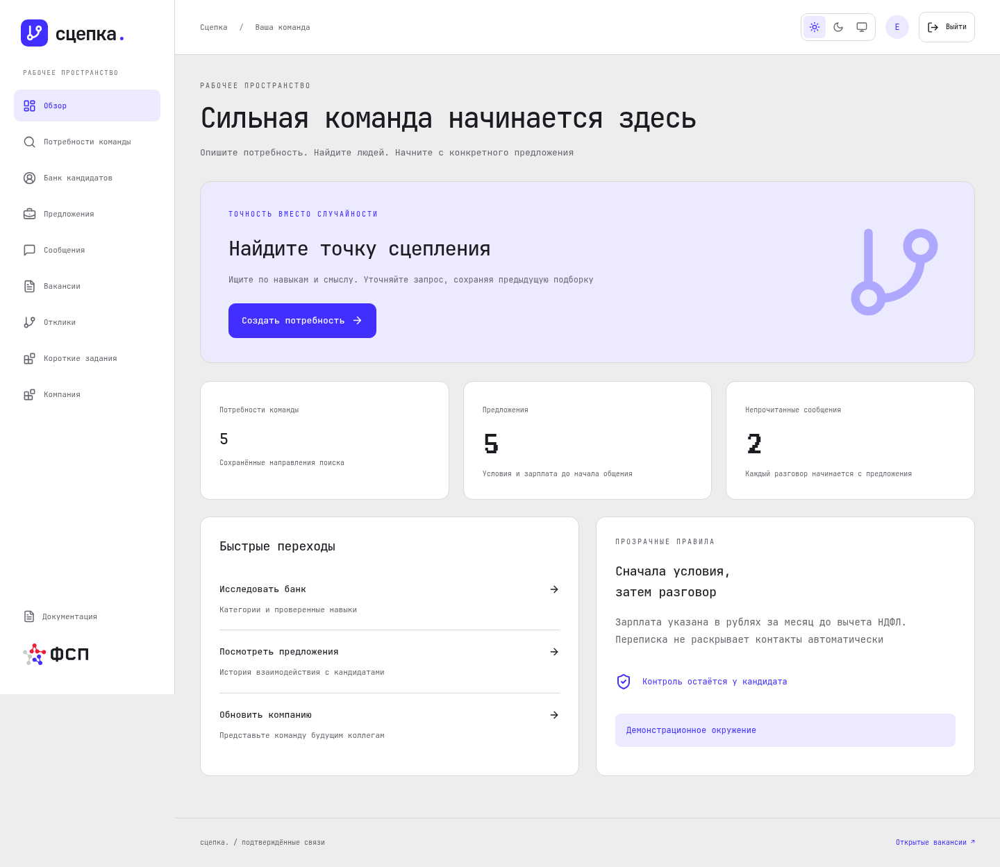
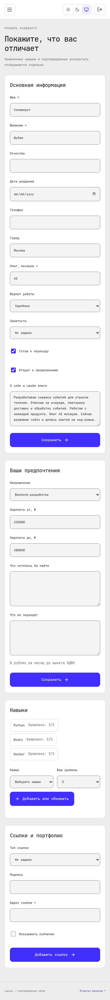
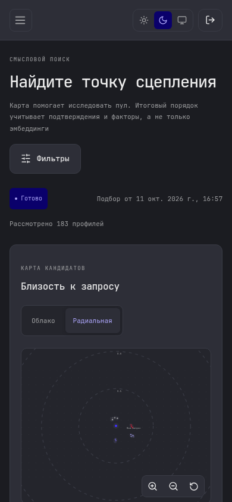

<picture><source media="(prefers-color-scheme: dark)" srcset="../brand/assets/logo/logo-short-on-dark.svg"></picture>

# Интерфейс Сцепки

Главная и рабочие кабинеты кандидата и работодателя. Интерфейс подключает пользовательские сценарии API, сохраняет историю поиска и помогает начать общение с конкретного предложения

## Возможности

- Светлая, тёмная и системная темы, адаптация под телефон, доступные формы и навигация
- Профиль, приватность, резюме, индивидуальные тесты и демонстрационная интеграция ФСП
- Потребности, вакансии, подбор, каталог, предложения, отклики и задания
- Связанные с выдачей карты кандидатов, история прогонов и уточнения запроса
- Переписка с условиями предложения и состояниями прочтения
- Брендированная документация из исходных Markdown-файлов

## Работа с проектом

[Запуск, конфигурация, демоданные и команды проверки](../docs/frontend/development.md) · [Архитектура](../docs/frontend/architecture.md) · [Контракт API](../docs/api/frontend.md) · [Проверки и скриншоты](../docs/frontend/validation.md)

| Телефон: профиль | Телефон: поиск |
| --- | --- |
|  |  |
