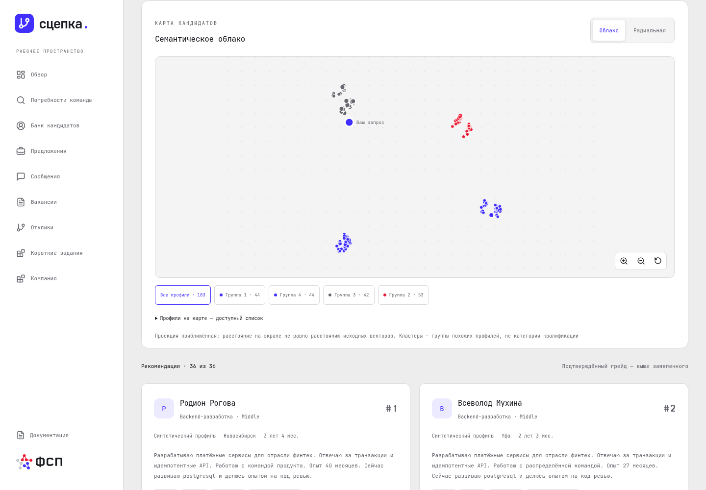

<picture><source media="(prefers-color-scheme: dark)" srcset="../brand/assets/logo/logo-short-on-dark.svg"></picture>

# Подбор кандидатов Сцепки

matcher подбирает кандидатов по потребности команды, оценивает соответствие и сохраняет историю уточнений. Карты показывают рассматривавшийся пул, а не весь каталог платформы

- [Механика подбора](../docs/matcher/matching-mechanics.md)
- [Архитектура](../docs/matcher/architecture.md)
- [Геометрия, история и приватность карт](../docs/frontend/architecture.md#карты-кандидатов)
- [Запуск и проверка](../docs/matcher/deployment.md)
- [Полная документация](../docs/matcher/README.md)
